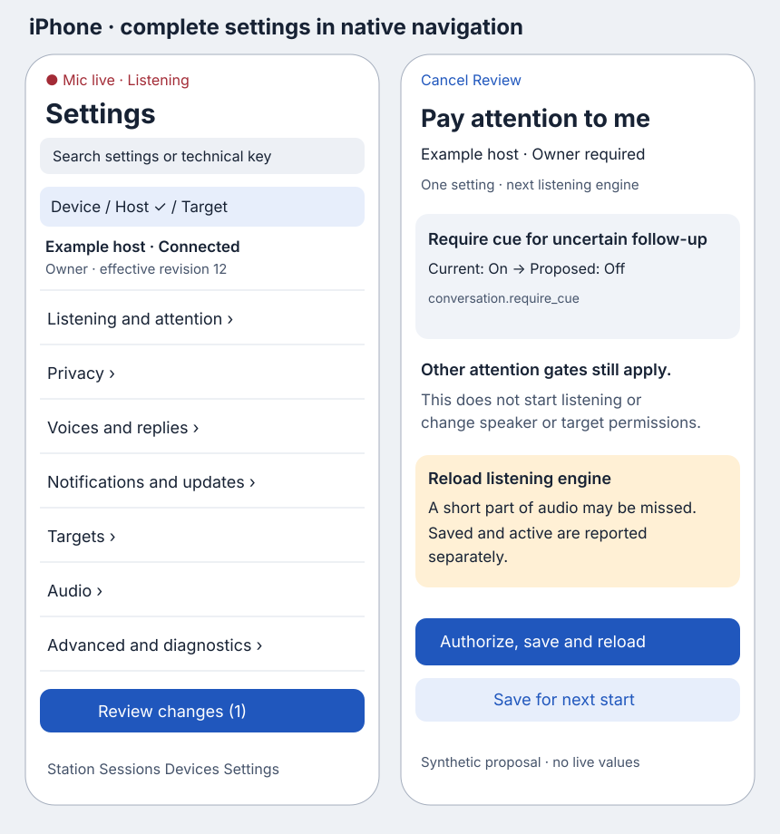
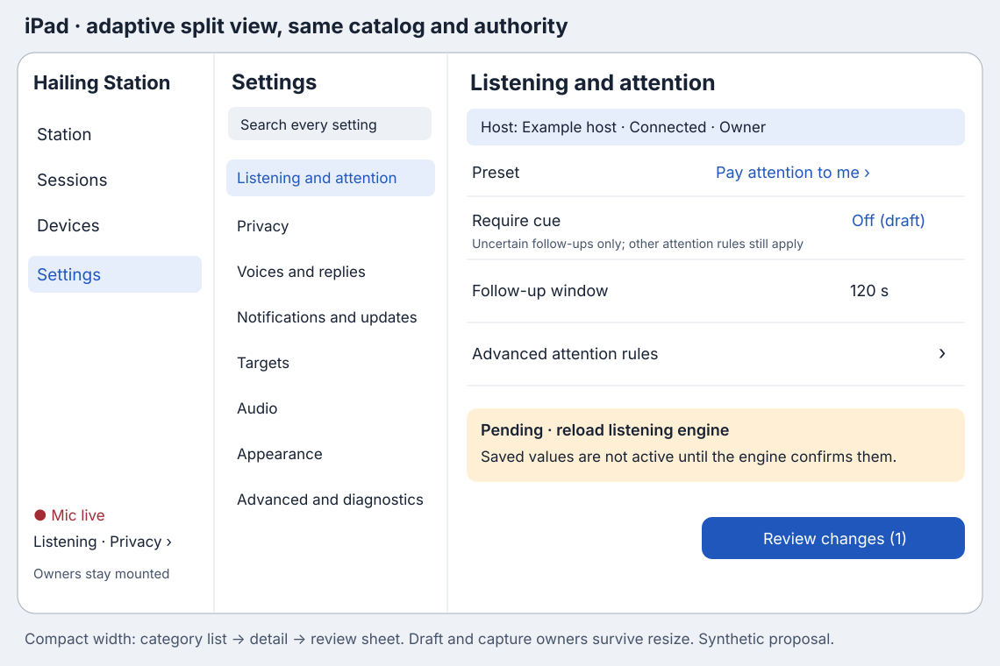
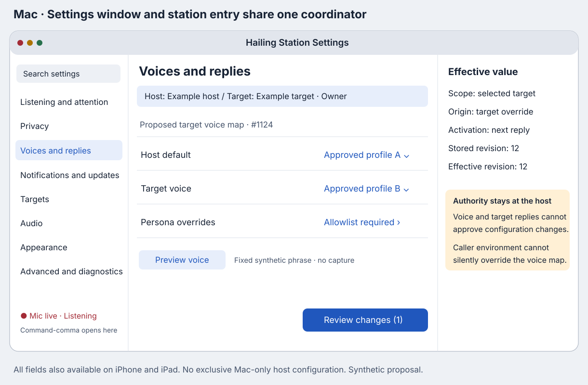
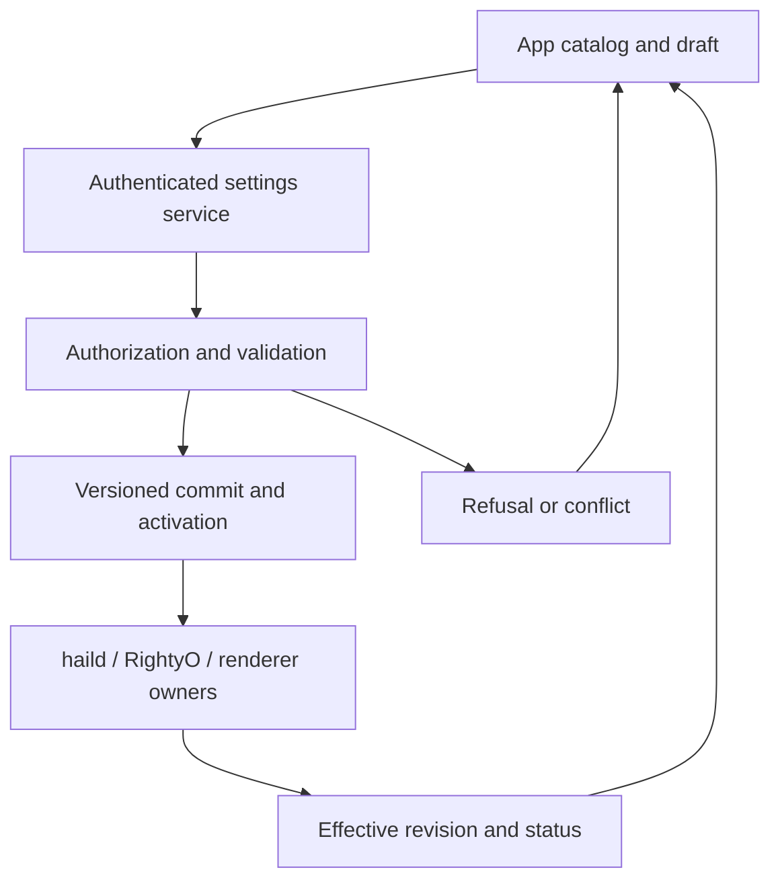

# Settings on every Hailing Station app

Status: **design proposal**, 2026-11-13. Part of [#1115](https://github.com/mickdarling/hailing-station/issues/1115); incorporates the voice ownership request in [#1124](https://github.com/mickdarling/hailing-station/issues/1124). This PR changes documentation only. No application, daemon, recognizer, renderer, or live configuration is changed or physically validated.

The product requirement is complete configuration from **iPhone, iPad, and Mac**, including RightyO and host settings. The same settings catalog, permissions, validation, warnings, and effective-state reporting must serve every app. Advanced means less frequently used; it does not mean file-only, Mac-only, or unavailable on a phone.

The companion [settings inventory](settings-inventory.md) is the source-level baseline, with definitions, readers, defaults, observed configuration, constraints, and current activation behavior. References there identify existing code. Names of new contracts and files below are proposed implementation boundaries.

## Existing behavior and the boundary this adds

The reviewed Hailing Station revision is `67e15fee3a4d3f24b53d50c2fa536f7693d54a8d`; RightyO is `2926986c5077de608de91d317863c7520f013209`. This is a reading/design snapshot, not a statement about the binary installed on any device.

- `StationNavigationShell` and `StationNavigationState` define Mac/iPad split navigation and iPhone tabs, with the station kept mounted across navigation. `ListeningPrivacyRailView` and `AudioRoutesSheetView` define state/intent views. Their presence is not proof that the production root has adopted them. The inventory distinguishes contracts/previews from production wiring.
- The existing public security boundary documents an unauthenticated personal-terminal WebSocket. A client-supplied device name is not an authenticated owner. Target listing, input routing, and the owner-only local reply socket do not together provide a remote settings authorization channel. See [security.md](../security.md) and [host-bootstrap.md](../host-bootstrap.md).
- RightyO reads its configuration into a process/controller. Writing its JSON does not update an already running child. `haild ambient reload` replaces an active RightyO child without starting an idle stream; audio around replacement can be lost. It is not a general host-config reload. Policy admission refresh and individual local app controls have different lifetimes; see the inventory.
- A voice route chooses a destination; it is not a reply voice assignment. #1124's host default, per-target reply voice and per-update-type lanes remain proposed at this snapshot. Its [2026-11-13 requirement](https://github.com/mickdarling/hailing-station/issues/1124#issuecomment-6862959360) fixes the direction: one restart-proof map, JARVIS for default/coordination and FRIDAY for status-only, with explicit allowlisted overrides rather than silent caller-environment selection. The settings UI must label unsupported fields as unavailable until the corresponding implementation exists.

This design deliberately extends the earlier bootstrap proposal's Mac-local administration boundary. Remote administration is a new, separately authorized capability, not a side effect of target selection. No general configuration write is enabled on the current unauthenticated listener.

## One catalog, explicit scope

Every settings screen begins with a scope control: **This device / Host / Target**. It shows a user-chosen host label, connection state, permission role, and last confirmed effective revision. Picking a different host never silently moves an unsaved draft. The owner chooses Keep draft or Discard; each draft remains attached to its original host and revision.

| Scope | Source of truth | Examples | Available from |
| --- | --- | --- | --- |
| This device | Existing app/audio owners, persisted locally when appropriate | Text size, reply segmentation, preferred microphone, local diagnostics, notification permission | All apps; an unavailable hardware capability remains visible with its reason |
| Host | haild settings service, host-managed files and launcher profile | Listener, RightyO configuration and launch options, policy, speech renderer, notifications | Every app after owner/admin authorization |
| Target | Exact stable target ID plus host identity and binding generation | Tier, input permissions, route names, reply voice, update preference | Every app, with per-target authorization |
| Developer | A scoped development profile, never an implicit change to production | Synthetic inputs, fixture adapters, diagnostic launch flags, test-only environment | Advanced on every app; authorized development role and explicit profile selection |

Do not manufacture editable settings for constants or injectable test closures that have no external configuration path today. Conversely, every actual config key, environment input, CLI argument, supported launch override, and app preference in the inventory needs a registered catalog entry. Invocation arguments (for example a notification's expiry) belong to a typed action composer or saved invocation profile under Advanced, rather than being misrepresented as permanent daemon defaults. Operational actions such as Reload, Inspect status, and Cancel update belong beside the relevant settings, not in a generic shell console.

An unsupported platform shows the setting, effective value if authorized, platform restriction, and available action. For OS-owned permissions/audio routing, expose the native permission request or settings destination on that device; for a remote host, send an authorized request to its host helper and show pending OS approval. Apps cannot guarantee that macOS/iOS will grant permission or expose an unavailable audio route. No field is silently hidden or described as successfully configured when the OS has refused it.

Host child launch profiles and app launch arguments are different. iOS/iPadOS cannot rewrite the OS-provided argv/environment of their running app. For supported development/startup behaviors, add a typed app-owned profile with equivalent bounded options, marked **Next app launch**, rather than promising OS environment mutation. Inherited/system inputs (for example simulator hardware identity) show provenance only. Debug-only authored seeding remains visibly synthetic and available only in eligible builds on every platform; release builds explain that restriction. If an operation requires an external developer launcher, expose the authorized worker-launch request and its observed result from every app. None of these paths silently edits shell startup files or changes the live voice session.

Each registered setting has: stable ID; human label; aliases including the exact file/env/flag key; type and unit; enum choices or bounds; default and default source; configured and effective value; owning scope; origin/precedence; sensitivity; read/write roles; activation class; dependencies; reset behavior; schema version; help and warning text. Secret entries return **set/unset**, never their value. Search matches all labels and technical aliases, including `conversation.require_cue` and `VBSAY_PROFILE`.

Coverage is an implementation acceptance rule: a catalog export must map every inventory row/member to a screen or action ID on each platform. A newly added supported setting cannot ship with only a file parser; it needs catalog metadata and an editor. Unknown keys from a newer daemon are reported as **Unsupported by this app**, never dropped on save. A schema-driven Advanced editor supports additional typed fields on all apps, without downloading executable UI or allowing arbitrary shell commands.

## Information architecture

All groups exist on all platforms. Common controls appear first; a disclosure expands less frequent controls without changing their scope or authority. Advanced also has an **All settings** searchable index, so an expert can reach a key without knowing its group.

| Group | Main controls | Advanced/detail controls and consequences |
| --- | --- | --- |
| Listening and attention | Listening state; cue requirement; attention preset; follow-up window; addressing names | RightyO decision thresholds, cue/continuation/answer rules, speaker recognition and confidence, ASR/attention backend, turn assembly, echo/noise rules. Display precise units, eligibility rules, and child-restart requirement. |
| Privacy | Stop listening; privacy state; rubber duck/meeting modes; retained content | Separate capture, transcription, transmission, dispatch, retention, and recording; speaker privacy controls; meeting timeout/recording policy; transcript/state logs and retention directories. Never collapse these into one ambiguous privacy toggle. |
| Voices and replies | Host default voice; target and update-type map; preview; playback and segmentation | Renderer choice/profile allowlist; explicit persona override policy; stream/file tempo, renderer chunking, reply pacing and deadlines, acknowledgements and reply-control options. Distinguish local playback rate from generation tempo. |
| Notifications and updates | Enable updates; target/source preference; hold/spoken/display mode | Existing notify/session-update/progress invocation fields, expiration/queue bounds, sound/badge options, APNs profile references and OS permission. Show configured vs currently deliverable; no invented quiet-hours host key. |
| Targets | Offered targets, selected target, tier, voice and route label | Allow/deny, exact binding, action/paste/launch permissions, route aliases/default, destination and adapter manifests, provider/recovery references. Selecting a target never grants it permission. |
| Audio | Active and preferred input; observed output; route picker | Bluetooth HFP behavior, system-managed output on Mac, reply onset/pause thresholds, route diagnostics and capture parameters only where externally configurable. No opening this page starts a probe or microphone. |
| Appearance and accessibility | Conversation text size, text presentation and local UI choices | App-only text size; system accessibility destinations; keyboard hints. App text size never changes system font settings. |
| Advanced and diagnostics | All settings search; status; configured/effective diff; reload/restart controls | Host bind/port/identity, managed paths, launcher environment/flags, RightyO backend/model/budget/logging, coaching/recovery/provider profiles, diagnostics/probes, compatibility/schema, import/export and reset. Risk and required role are visible on each row. |

Repeated settings are the same entry, not duplicate persisted values: an audio onset threshold surfaced in Audio and a reply segmentation detail both edit the same device setting ID. Advanced technical aliases show the source file/env/flag for support; ordinary screens use plain-language labels.

## Shared row and editing behavior

A row shows **label**, current effective value, scope badge, and one activation badge: **Immediate**, **Next reply**, **Next process**, **Reload listening engine**, **Restart host**, **Restart app**, **System approval**, or **Not supported**. Opening its help reveals the default, configured value, override source, bounds, privacy/authority effect, and whether a live stream or reply is affected. Missing/unknown effective state reads **Not confirmed**, not the last configured value presented as live.

Use `Form`/`Section`, `Toggle`, `Picker`, `LabeledContent`, `TextField`, and bounded `Stepper` controls with a numeric editor. Sliders are optional aids, never the sole way to enter a precise threshold. Durations explicitly say milliseconds or seconds; probabilities show decimals and an accessible percentage description. Multiline lists have add/remove controls and validation, not comma-encoded strings. File locations use a host-owned picker/reference browser with existence, ownership, permission and containment checks. A phone never tries to open a Mac path in its own filesystem.

Local harmless presentation controls can apply immediately with Undo. Host and target edits form a draft: **Review changes (N)** opens a before/after list, warnings, affected host/targets, and activation steps. Security/privacy edits always require a trusted visual interaction plus fresh owner authorization. The Apply button names the effect: **Save for next start**, **Save and reload listening**, or **Save and restart host**. A page transition does not apply a draft. Back navigation preserves it with a draft badge or explicitly discards it.

During a call or a spoken reply, present disruption honestly: “Reload replaces the listening engine. A short part of audio may be missed.” Offer **Save for later** and **Reload now**, subject to the owner's authorization. Never toggle listening off/on as a hidden implementation detail or auto-resume capture after a failed change. Persist **Pending activation** across reconnection until the service confirms the new effective revision.

## Platform layouts and wireframes

The wireframes are synthetic proposed states; labels such as “Example host” identify no real endpoint or device. They illustrate the same catalog and review contract on every app.

### iPhone

Keep the shell's Station / Sessions / Devices / Settings tabs. The Settings tab contains a `NavigationStack` with searchable grouped `Form`, scope picker, connection/role summary, and a visible pending-changes bar. Push details; use a sheet for review, authorization, voice preview, or system route picker. Long technical values wrap/select/copy only when authorized; the controls never require horizontal scrolling. Advanced remains reachable with one group tap, including host networking and RightyO models.

Retain the top `MicLiveIndicator`, listening state and route back to Station. Preserve the production capture/connection owners above navigation, following the shell's mounted-station contract. Settings navigation must not trigger `onDisappear` capture teardown. Where a system sheet interrupts access to the rail, microphone status remains available from the system and the app resumes the same observed state, not a reconstructed optimistic state.

### iPad

Use the existing adaptive `NavigationSplitView` shell with Settings selected. Inside Settings, a category list and detail form use the available width; at compact width collapse to a single back-navigation stack. Keep the user's category, search and draft while resizing/rotating/Stage Manager changes width. An optional inspector explains selected settings and effective values. The listening/privacy rail remains visible in the shell/sidebar, and the station remains mounted. Review is a sheet sized for comfortable touch reading, not a phone panel stretched across the screen.

### Mac

The station sidebar Settings destination and **Hailing Station → Settings… (Command-comma)** open the same settings coordinator/catalog and drafts. A SwiftUI `Settings` scene can host a separate window, with a category sidebar and form; it must reuse the app-root service owners. Show scoped host/target selection prominently. Support keyboard search, tab navigation, copyable technical keys, and a review sheet with a full diff. Mac-only conveniences are additional entry points, never exclusive capabilities: all host, path, credential and developer settings also have the authorized remote editor on iPhone/iPad.

Use the Revision B components as replaceable renderers. `ListeningPrivacyRail` opens the Privacy detail; `DestinationControl` links to the selected target's settings without changing selection; `AudioRoutesSheet` shares audio state/intent owners with Audio settings; `VoiceDock` continues to reflect reply state; `RecoverySheet` reports interrupted apply/reconnect without minting authority. Appearance controls and `MicLiveIndicator` read existing owners, never become owners themselves.

## Proposed configuration control plane

Names in this section describe a new protocol; they are not existing frame cases. Keep schema/validation and UI rendering separate from runtime owners. A proposed `SettingsCoordinator`, above all navigation branches/windows, holds snapshots/drafts. It sends typed intentions to a host settings service; only that service writes host files or invokes lifecycle operations.

### Read, validate, commit, activate

1. Authenticate the device and host over a confidential, replay-resistant channel; negotiate settings schema/capabilities and an authorized scope. Discovery and display labels convey no write authority. A viewer receives only authorized, redacted values, not private paths or secrets by default.
2. Read a snapshot with `hostIdentity`, `scope`, `schemaVersion`, `storedRevision`, `effectiveRevision` per subsystem, capability list, provenance, roles and redaction metadata. Also return actual installed binary/schema versions. A file hash alone does not prove the running child uses that configuration.
3. Stage a typed patch with `expectedRevision`, explicit setting IDs, values, requested activation, and a unique transaction ID. Never submit a whole arbitrary JSON document from a client or let an unknown key overwrite future settings. A newer unsupported schema is readable as a compatibility notice and refused for writes.
4. Host validation repeats all decoder bounds and semantic checks, plus cross-field constraints, file trust, target bindings, paths and required executables. Validate against a complete candidate configuration. Return field-specific errors and an exact plan: files affected, security changes, active streams/replies affected, activation classes, expected disruption, and required authorization. Validation performs no probe, model download, subprocess execution or listening start.
5. The owner reviews the plan. Fresh local device authentication (and host-authorized role/capability) approves its exact digest, host, scopes, revision and expiry. Device unlock alone is insufficient authority; an untrusted device cannot obtain an admin capability by claiming to be the owner. Voice-origin, target-origin and model/tool messages are categorically refused for settings writes.
6. Commit with compare-and-swap under the host's writer lock. Recheck authorization, current revision, revocation and target binding immediately before writing. Preserve existing policy permission and fail-closed admission guarantees. Return a durable transaction receipt; loss of connection is **Outcome unknown** until querying that transaction ID, never an instruction to blindly resend a new transaction.
7. Apply only the accepted activation plan. Verify the resulting effective generation per subsystem and publish redacted status to every authorized app. **Saved** and **Active** are different receipts. An active listening run may need replacement; an idle service must stay idle. App reconnect does not restore old capture, policy grants, privacy relaxations or unconfirmed modes.

Bind child replacement to the current listening, privacy and mode generations, not just the file revision. Before the first PCM frame, seed the replacement with the latest confirmed private/media/meeting state and its valid owner standing. A concurrent Stop, privacy tightening or authority revocation invalidates queued activation and wins over an earlier reviewed reload. Do not fall back to an unseeded child, restore a stale mode after reconnect, or replay audio buffered across the replacement gap. If required state cannot be transferred safely, leave capture stopped and report the blocked activation.

### Storage and competing writers

The host keeps an owner-only versioned configuration store/manifest with immutable revision directories and an atomically replaced current reference. Host JSON, RightyO JSON, routes, invocation profiles and launcher environment are serializers behind that store; credentials stay in a secure host store referenced by opaque handles. The migration must preserve existing CLI policy transactions and external-editor compatibility rather than introduce a second authority beside `PolicyFile.update`.

There is no filesystem primitive that atomically commits unrelated existing files together. Before multi-subsystem changes ship, provide a journal, staged validated snapshots, a commit marker and crash recovery. Runtime owners consume only a complete committed manifest. Existing per-file policy CLI writes enter the same serialization/revision boundary or are detected as external changes before any dependent commit. Until that adapter exists, disallow bundled policy plus engine/host changes and offer separate reviewed transactions. Never claim cross-file atomicity from two successive renames.

On external edits, detect change, validate and increment revision; if unsafe/malformed, show **External configuration invalid**, keep admission fail-closed, and do not overwrite the file automatically. A stale app gets a conflict with its draft preserved and a fresh before/after diff. A disconnected app may retain a non-secret draft but cannot queue privileged commits for automatic later execution. At reconnect, revalidate everything and ask the owner to apply it visually.

Store configured intent separately from effective launch environment. A process environment is not mutable from another process. An env/flag change edits a managed launcher/invocation profile and reports **Next process**; it does not claim to patch already-running sessions. For inherited caller overrides, show **Overridden for this reply/process** and offer a reviewed managed-profile change. Do not mutate unrelated shell startup files.

### Activation classes

| Class | Current baseline / proposed implementation | Required UI truth |
| --- | --- | --- |
| Device immediate | Existing owner mutation for ordinary local controls | Confirm actual owner state; undo returns through that owner |
| Next reply/job | Per-invocation options and renderer environment | Do not alter an in-flight spoken reply or equate a saved profile with caller adoption |
| Next child | RightyO loads config at startup | Offer save pending, or reviewed child reload; toggling listening only counts if it actually creates a new child |
| Policy admission | Existing policy refresh/generation logic | Confirm the new policy generation; revoke stale grants/bindings before acknowledging effective authority |
| Host restart | Startup bind/port/config paths/daemon flags | Persist candidate, stop safely, start known binary, reauthenticate/reconnect, verify revision; never build/deploy as part of Apply |
| App/audio owner recreation | Some device preferences are sampled at owner creation | Explicit restart requirement or a future controlled owner recreation; preserve privacy stopped state |
| External/system | OS permissions, routes, renderer backend/model installation | Show permission/install state and explicit external action; no silent download, recording, or false completion |

For listener address/port changes, stage a bounded reconnect plan using only authorized endpoint descriptors. On failed reachability, the host helper restores only the previous connectivity/launch fields implicated in that failed activation after the reviewed timeout and leaves capture stopped; the app reports rollback vs unknown state distinctly. It must preserve policy/privacy tightening from the same transaction and all later commits, not restore an entire old manifest. This recovery cannot depend on the connection it just severed. Do not start a second unauthenticated listener to bridge migration.

## Safety and authority

| Role | Can change | Cannot acquire implicitly |
| --- | --- | --- |
| App user | Their device presentation/playback preferences; permitted actions under current host policy | Host policy, another device's preferences, recording/retention grants |
| Owner | Authorized personal listening/voice/target choices and approved privacy settings | OS permission or administrative service privilege by a model's request |
| Host admin | Network/paths/process launch, credentials, policy and trust management within granted authority | Different host/account access, arbitrary client-supplied code execution |
| Developer | Explicit dev-profile/synthetic/diagnostic configuration | Production administration or real-data capture by selecting a test flag |

All privacy/authority **configuration** changes require the trusted visual control plane: cue/attention relaxation, speaker thresholds, destinations/routes/bindings, tier/allowlists, recording/retention, diagnostics that collect content, network exposure, credentials and executable/backend choices. Speech, transcript content, model outputs, notification payloads and target replies cannot call this plane or approve its prompts. Setting labels/help from a host are untrusted display data, never instructions or executable form content.

Advanced action composers use the same authorization, plan-digest, visual review, expiry, revocation and audit boundaries whenever an action can capture/upload speech, expose stored content, enroll/delete identity, reset policy, invoke a Shortcut, or start/restart a process. Renaming a mutation an action is not a bypass. Pure bounded status reads may use viewer permission. Opaque request/qualification/token fields are generated and bound by their existing owner; the expert editor never lets a user forge authority by typing them.

Existing voice controls are separate runtime actions, not proof of configuration authority. Preserve a one-way **Stop listening / stop playback** emergency action from any permitted local control, including voice where already supported; it may reduce activity, never expand permission. Current spoken duck/meeting behavior must be audited against this boundary before integrating settings. Do not silently retain an existing voice path that can relax privacy around the new visual gate. Resuming capture, enabling recording, changing meeting retention, and loosening speaker/cue requirements require owner visual authorization in the proposed system.

Remote administration enrollment requires explicit host-owner approval, verified device keys and revocable scoped capabilities; protect stored keys with platform secure storage. Use fresh local authentication for sensitive commits, short-lived plan approvals, per-scope roles, expiry, rate limits and replay protection. Revocation invalidates pending plans and sessions. A locked/revoked/untrusted app can show permitted read-only status and a clear request-access workflow; it cannot write, even on the same network.

Secret fields support provision, replace and revoke from every authorized app over the secure channel. They never read back existing material, sync into drafts, enter exports or appear in audit. Device settings never copy host credentials into `UserDefaults`. Host filesystem operations use constrained references and approved roots; editing a path/profile cannot become remote arbitrary execution. High-risk development overrides remain available from every app under the dev/admin boundary, with a reviewed host-approved executable registration process.

Audit only actor capability reference, setting IDs, redacted value categories/digests, revision, time, result and activation status. Do not record transcripts, spoken previews, raw private paths, endpoint addresses or secrets in shareable diagnostics. An owner can inspect private local details separately. Reading settings does not enable diagnostics or content retention.

## Presets that explain what they really change

Presets are versioned patches over existing settings, not hidden modes or substitutes for authorization. Show their exact changed fields, stored/effective diff, overrides and activation plan before applying. Mark a modified preset **Custom**; do not overwrite unrelated keys when reselecting it.

| Preset | Proposed patch | What it promises / does not promise |
| --- | --- | --- |
| Pay attention to me | Set `conversation.require_cue=false`; leave window, decision/speaker thresholds, target policy and privacy unchanged initially | Relaxes the uncertain-follow-up cue gate; does not guarantee every utterance is attended, start listening, or authorize delivery. Owner visual approval; next RightyO child. |
| Require clearer follow-ups | Set `conversation.require_cue=true`; keep other thresholds as configured | Applies that particular follow-up gate; selected-attend and reply-answer paths may behave differently. Preview the actual rules from the installed engine. |
| Quiet replies | Set permitted update speech preferences to display/hold using the implemented update controls | Does not stop capture or imply Private mode. No speculative persistent notify key until its owner exists. |
| Privacy stop | Invoke the existing stop owner action first; keep stopped while reviewing optional retention/diagnostic changes | Stop is an action, not a claim to delete old content. Any deletion is a separate scoped, explicit operation. |

Do not invent a universal probability bundle without evaluating its behavior. In particular, the inventory explains that a setting named an enrolled follow-up minimum can lower a threshold through `min` semantics rather than raise it. Show the computed effective rule and warn about coupled fields. The first implementation should expose separate precise controls and a narrowly scoped cue preset; additional attention presets need causal evaluation and owner feedback.

Voice preview uses an explicit **Preview voice** tap with a fixed synthetic phrase and chosen output, under current output permission. It never submits real conversation text, starts capture, changes the target or persists the preview selection. For #1124, direct replies resolve target profile then documented host default; proactive updates and status lines resolve their explicit update-type lane then host default. The owner-approved lane map remains stored in HS across all process/session restarts. An explicit per-reply persona override may win only when host-allowlisted for that target/type and audited content-free. Arbitrary caller `VBSAY_PROFILE` is removed or overridden by the resolver, not adopted as a settings change. A missing configured profile selects only the documented valid fallback and raises a doctor warning; if that fallback is unavailable, hold speech and retain the visible update/error instead of silently choosing the renderer's built-in voice. Show the resolved profile and its reason in each app and host status. The exact fallback profile is an owner decision; the prohibition on silent environment drift is already settled.

## Undo, reset, recovery and accessibility

- **Undo:** retain the prior non-secret revision and offer Revert after application. Reverting host settings is a fresh checked patch against the current revision, not restoration of a stale whole file. If another app edited related fields, show a conflict. A revert that broadens privilege/privacy requires fresh owner authorization. Never undo a stop by silently resuming recording/listening. Secrets are replaceable/revocable, not recoverable from a UI undo stack.
- **Reset:** per field, per group, then per scope; show the precise default source/version and impact. Custom live values are not confused with defaults. Resetting policy starts from deny-all and does not invent target grants. Resetting app preferences does not revoke host trust or erase content. Credentials, pairing, recordings/transcript deletion, and target bindings require separate named operations. No “Reset everything” shortcut that combines all destructive effects.
- **Partial failure:** distinguish rejected validation, conflict, saved/pending activation, activation failed, rolled back, and unknown outcome. Per-subsystem revisions expose partial activation. When a child reload fails, keep the known running child if possible and report that the new config is pending; if state cannot be established, show Unknown and keep capture stopped rather than guessing success. A rollback of settings never rolls back independently tightened policy or resurrects expired authority.
- **Accessibility:** honor Dynamic Type, VoiceOver, Voice Control UI navigation, Reduce Motion, increased contrast and keyboard focus. Voice Control operating a trusted UI is subject to the same sensitive-action authentication, not equivalent to an audio-origin API write. Use text/icons plus color for risk and live-mic state. Targets, scope, pending status, units, default, effective value and changed value are read in a useful order. Provide large touch targets, multiline help and exact-value entry. Announce apply/reload outcomes without speaking secrets or interrupting an existing spoken reply. Focus returns to the changed row after review; wide and compact layouts keep reading order. `Aa` remains conversation-only; controls continue to follow system accessibility text sizing.

## Small-PR implementation sequence

This is a proposed sequence, not work executed by this documentation PR. Each row is an issue-linked PR slice; **at most four production files per PR**, using the exact exclusions and rename rules in `scripts/pr-shape.py`. Names below are suggested new boundaries, not assertions that files already exist. If integration requires a fifth file, split the slice again. Do not move production owners into view factories to meet the count. Changes to protocol/security paths use the required labels, protocol-version handling, genuine exact-head review and independent second key; docs/tests are excluded from the production count, not from review.

| Phase / small PR | Production-file budget | Acceptance and later verification |
| --- | --- | --- |
| 0. Inventory and design | **0**; this PR's Markdown/SVG only | Source references, coverage, scope and safety review. No builds/test suites on the live-voice main computer. Draft stays unmerged pending decisions/review. |
| 1. Catalog value contracts | Up to 3: descriptor, snapshot, activation value types | Stable IDs, units/roles/redaction/default/effective distinction, unknown versions fail safely. Focused pure-model tests on an appropriate worker host. |
| 2. Owner-authenticated administration boundary | Separate PRs for host enrollment/verifier (≤4), client credentials/transport (≤4), revocation (≤4) | No settings writes until all slices compose; adversarial replay, forged identity, revoked/expired approval, voice/tool-origin and plaintext-channel refusals. Respect protocol and security review gates. |
| 3. Read-only protocol messages | Up to 3: protocol cases, schema registration, codec | Versioned, size-bounded, capability-filtered snapshots; no secrets/paths to unauthorized viewers. Protocol bump/fixtures and compatibility proof. |
| 4. Host catalog readers | Split host/policy/routes (≤4) from RightyO/renderer/providers (≤4) | Every inventory key/member has descriptor/provenance. Read-only startup; no subprocess/probe/model download. Coverage mapping and malformed-config cases. |
| 5. Validation and revision store | Separate validator/patch PR (≤4), journal/manifest PR (≤4), CLI/external-writer adapter PR (≤4) | Cross-field bounds, atomic single-scope update, crash recovery, conflict and external-edit detection; bundled changes disabled until coherent commit exists. |
| 6. Apply/activation adapters | Separate policy (≤4), RightyO reload (≤4), launcher/restart (≤4) and renderer/profile (≤4) slices | Saved vs effective receipts, idle stays idle, no duplicate child, no implicit capture resume, timeout/reconnect/rollback under fault injection. No production restart during development verification. |
| 7. App coordinator and generic forms | Up to 4: coordinator, catalog form, row editor, root integration | Snapshot/draft owners above navigation; searchable complete Advanced surface, stale revisions preserved, accessibility identifiers. UI owners issue intents only. |
| 8. Platform entry points | iPhone root/settings tab (≤2); iPad adaptive category/detail (≤3); Mac Settings scene/commands (≤3), separate PRs | Same catalog/actions/capabilities across platforms, mounted station maintained, no extra controller creation on window/tab/size changes. |
| 9. Listening/privacy/audio pages | Split each component and its owner integration into ≤4-file PRs | Precise cue semantics, mode gates, stop precedence, no auto-probe; effective audio routes vs preference; explicit owner-recreation requirement. |
| 10. Target/voice/update pages | Separate ≤4-file PRs per page; #1124 map/service integration is its own slice | Target identity/binding preserved, voice precedence and fallback explicit, update expiry/queue/progress controls reflect real owners. All mobile capabilities match Mac. |
| 11. Presets/review/undo/reset | Each component plus one owner adapter, ≤4 files per PR | Exact diff, activation warning, authorization, coupled-threshold explanation, stale undo refusal, reset deny-all, secret exclusion. |
| 12. Diagnostics/import/export and release qualification | Separate ≤4-file PRs, plus docs | Redacted export, schema-safe import, complete inventory-to-UI parity, permission/notification/route restrictions; accessibility and physical iPhone/iPad/Mac qualification on a non-live worker/device plan. |

Before each implementation PR: read current AGENTS, issue spec, checker and template; count production files (including both sides of renames); name the exact acceptance criteria and real deferred tests. Finish commits, compare full local/remote head, obtain the required completed independent review(s), then record truthful verdicts/evidence. A pending draft has no fabricated approval. Build/test commands in those future PRs run only on an authorized worker environment, not this live voice session. This design PR cannot establish physical-device behavior or runtime reload correctness.

## Five owner decisions before implementation

1. **Remote administration:** approve every trusted personal app as a possible owner/admin editor after explicit host pairing, or require separate admin grants per device? The design supports full editing on all platforms; this determines enrollment and authorization friction.
2. **Attention preset:** should “Pay attention to me” initially change only the uncertain-follow-up cue requirement, or should we evaluate a broader threshold/window bundle? The current cue flag is not a universal attention switch.
3. **Missing voice:** which explicit fallback profile should each lane use when its configured voice is unavailable? The settled rule is that caller environment cannot silently override the map; if both the mapped and approved fallback profiles are missing, this design holds speech and shows the update/error.
4. **Activation policy:** default to save pending activation during active listening, or offer an immediately reviewed reload with its possible audio gap? Host restart always needs an explicit disruptive-action review.
5. **Privacy defaults:** what retention, meeting-recording and content-diagnostics defaults should new profiles use, and should existing content-bearing configurations require a one-time visual review during migration? Reset and upgrade must not silently increase capture or retention.
