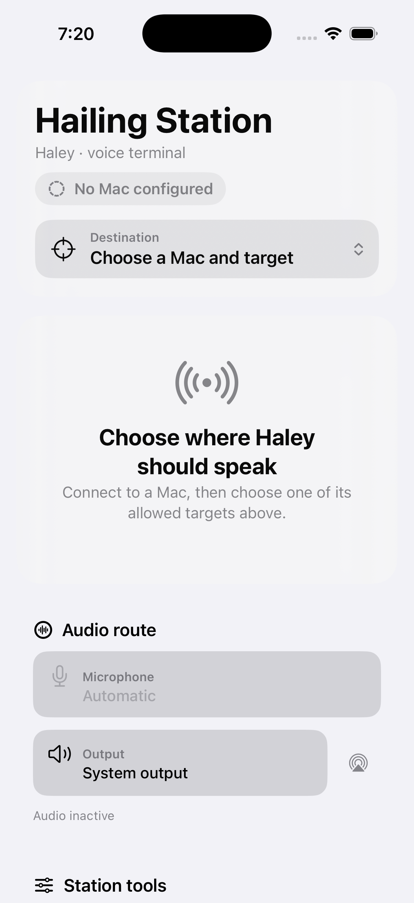
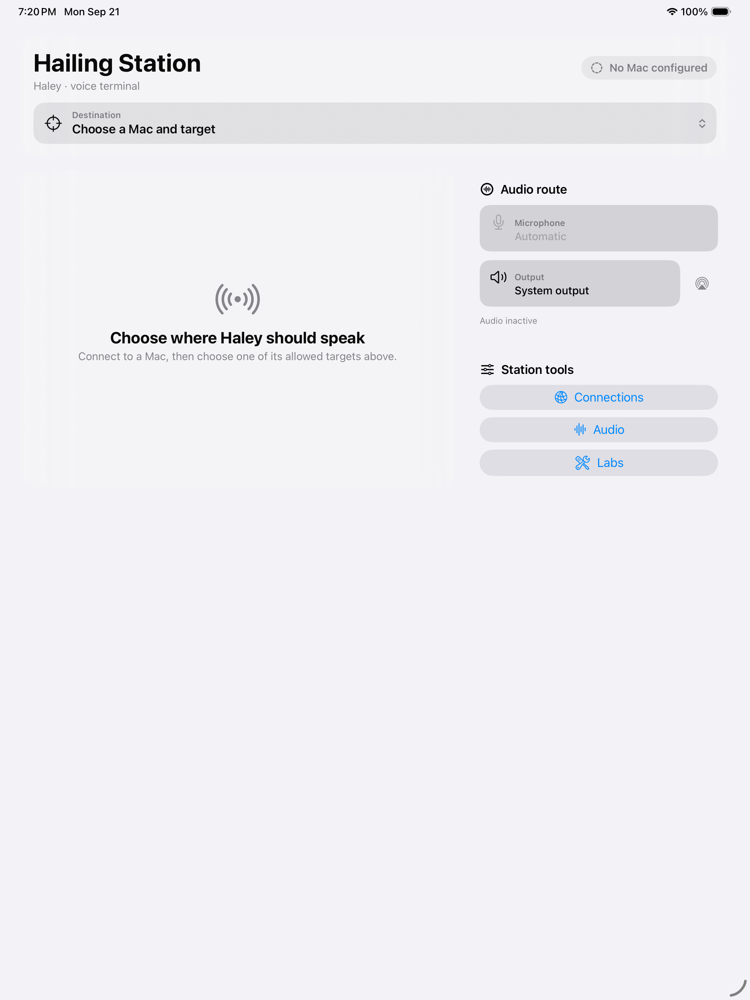

# Mobile interface

Hailing Station uses one state tree for iPhone and iPad. The interface rearranges the same destination, capture, reply, audio-route, and utility surfaces; it does not maintain separate phone and tablet products.

## Representative layouts

### iPhone, compact width

The compact layout is a single scrollable column. Connection and destination stay first, followed by the conversation, audio route, and secondary station tools. The destination browser adapts to a sheet.

### iPad, regular width

The regular-width layout keeps the conversation in the primary column and moves audio routing and station tools into a secondary column. The destination browser remains an anchored popover.

These screenshots use the sanitized unconfigured state on iOS/iPadOS 26.2 simulators. They contain no private endpoint, device, or transcript data.

## Interaction notes

- The selected Mac and target, plus connection health, remain visible above the conversation.
- Tap to talk is the primary action. A second tap stops capture, finalizes on-device transcription, and sends immediately.
- Escape remains a separate destructive action so a running host process can be interrupted without starting another utterance.
- Each sent request appears in the conversation thread as You (#318); there is no separate last-request panel or edited-correction action (#429). While capturing, a read-only live caption below Tap to talk shows the words as they are recognized, then clears. Labs > Live transcription keeps its last transcript, read-only.
- Microphone and output are glanceable on the station. Microphone choices use the injected audio-session controller while output uses Apple's native route picker.
- Automatic microphone order is USB, wired headset, then built-in. Station tools > Audio has an iOS/iPadOS setting, "Use AirPods / Bluetooth headset microphone" (#905). It's off by default, because Bluetooth HFP puts AirPods in call mode (mono, lower fidelity). While it's on, a Bluetooth headset mic is listed and comes after USB and wired but before the built-in mic. The setting applies at once to an active session and otherwise at the next start. An explicit microphone choice is kept; if that choice is an HFP mic and the setting is turned off, the session falls back to the next automatic input and returns to the headset if the setting is turned back on.
- Replies retain transcript, source identity, playback state, pause/resume, replay, and mute controls.
- Connections, detailed audio diagnostics, and experimental labs remain reachable but are visually secondary.
- VoiceOver exposes stable identifiers and labels for connection, destination, audio route, talk, and playback actions.
- Light and dark appearance were visually checked. The compact surface remains scrollable at the largest accessibility Dynamic Type category, and the destination control changes to a vertical label so its value remains readable.

## Device validation

On 2026-09-21, a physical iPad on iPadOS 26.6.2 passed both of these sanitized checks with the adaptive interface:

1. Restore the remembered destination and expose the active two-column conversation without reselecting it.
2. Open the transcription lab, start capture, observe incoming audio buffers, stop capture, and return to the ready state without terminating the app.

At the time of that record (before #429 removed the editor), the regular-width active view kept the selected destination, transcript editor, tap-to-talk control, Escape, audio route, and station tools visible in one screen. The automated compact-width smoke test also verified the station chrome before and after iPhone rotation.
