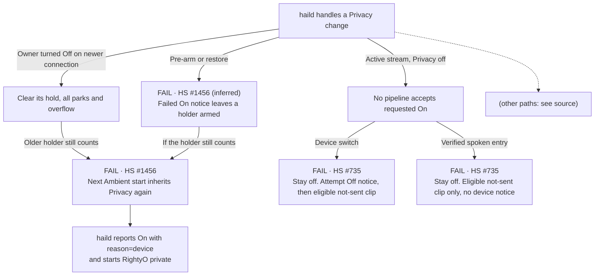
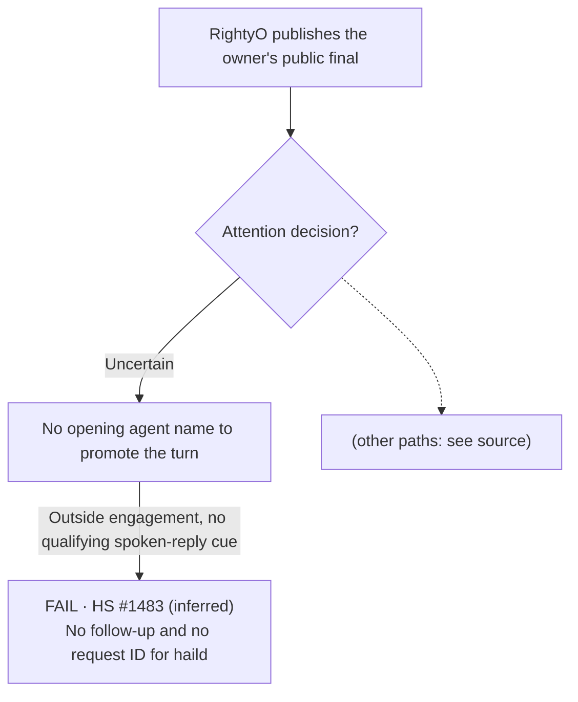
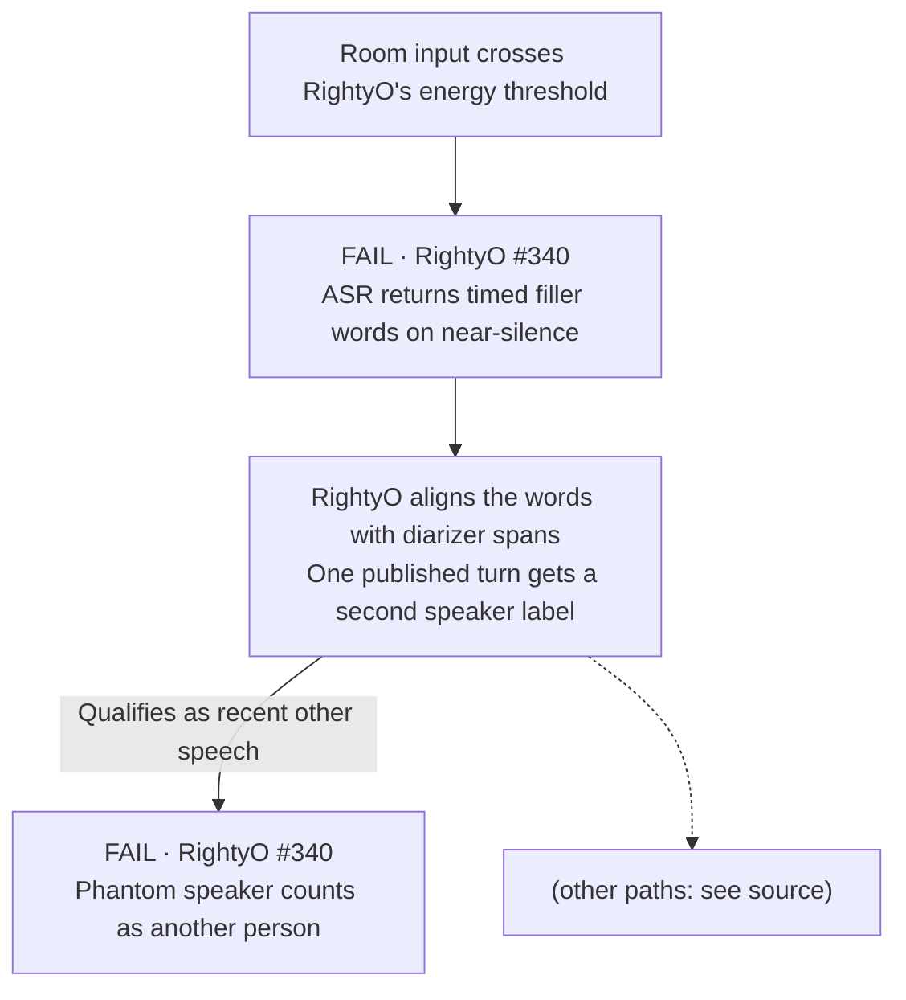
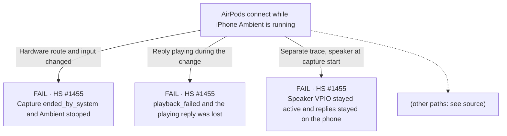
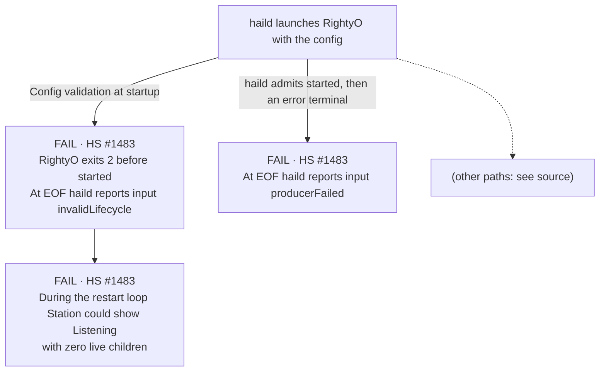
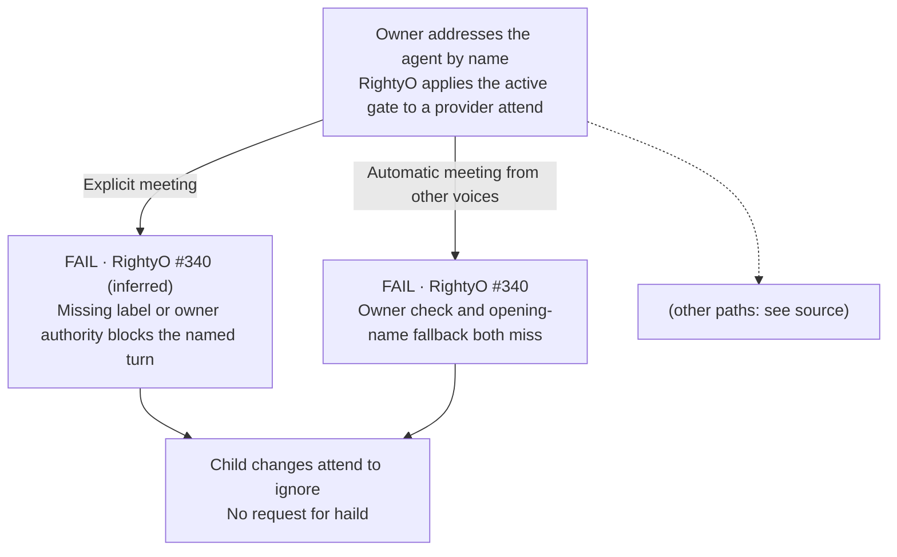
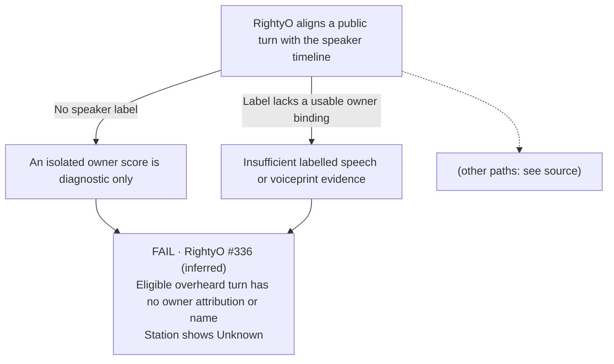
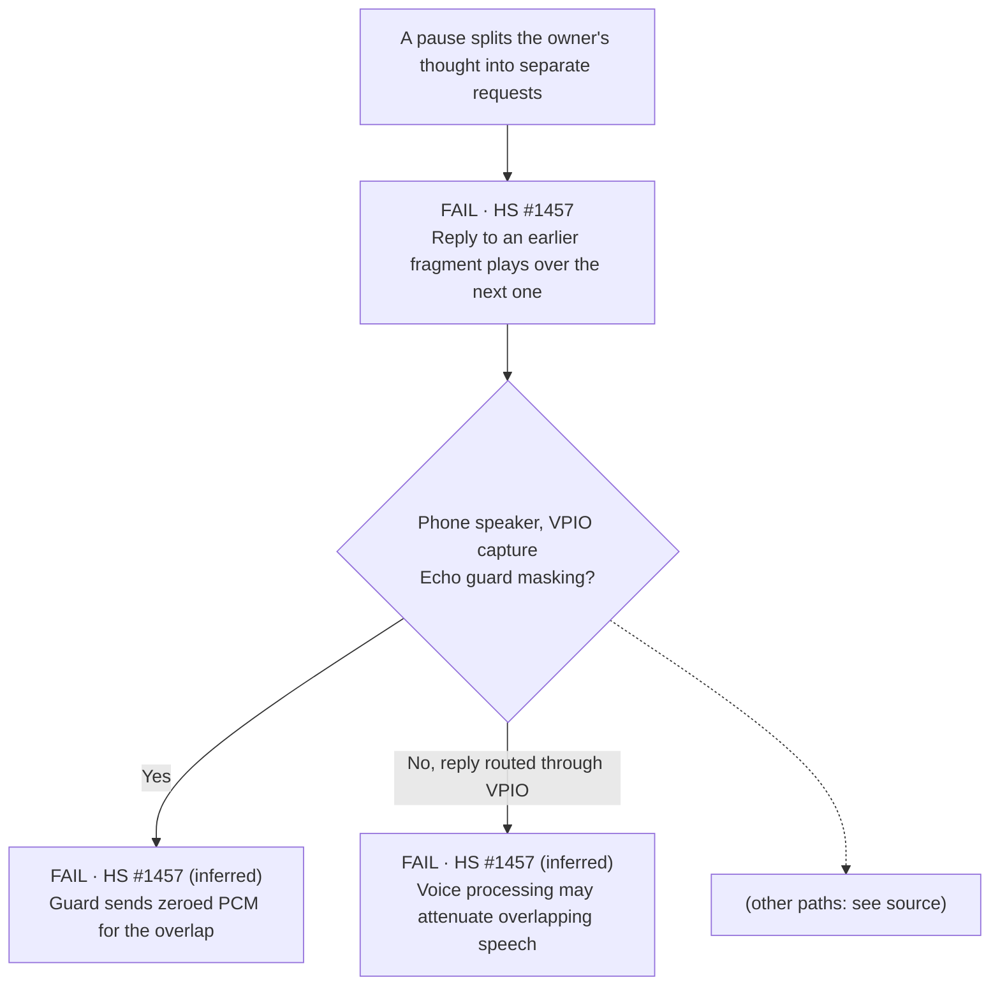
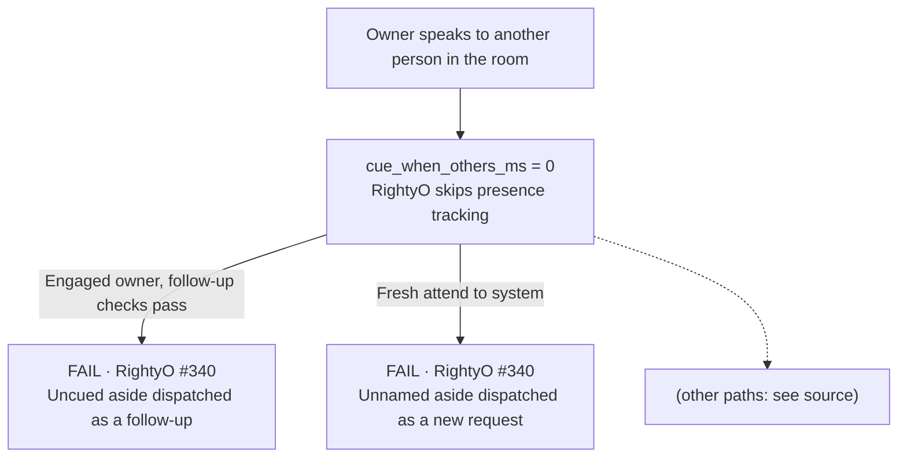
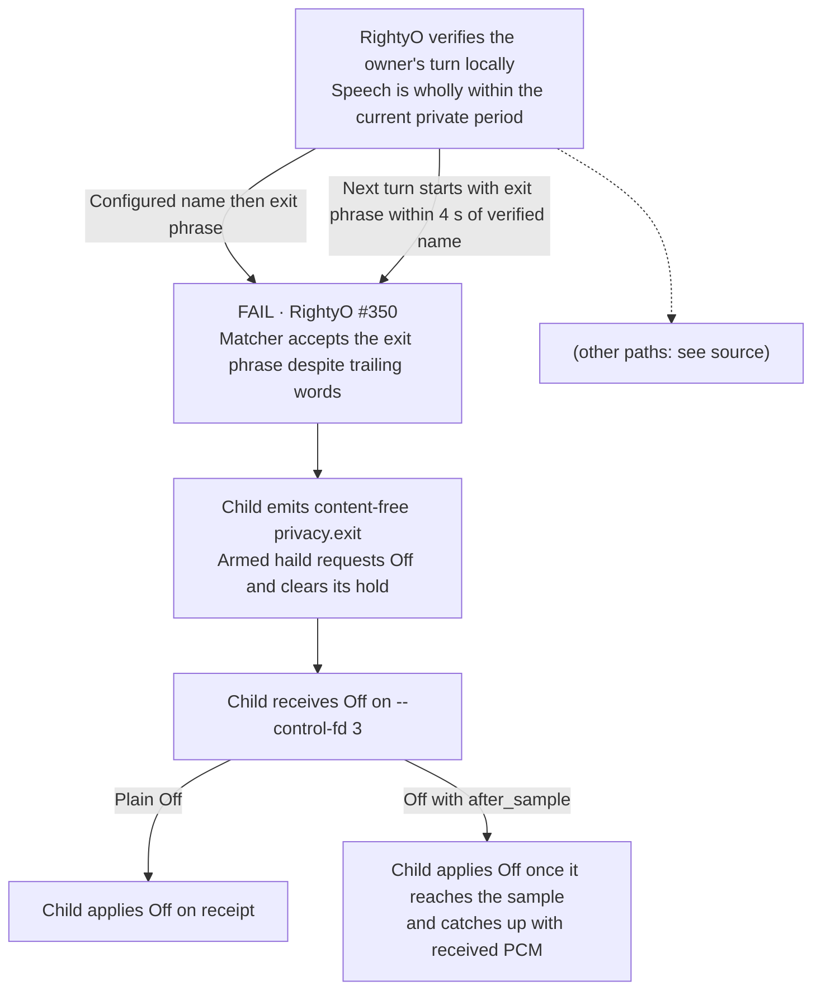

# RightyO failure flows

These ten flows trace the owner's reports to decisions on merged main at [Hailing Station `c36e1497`][hs-main] and [RightyO `f134780`][ry-main]. **FAIL** marks the decision or outcome behind a symptom. **(inferred)** marks a possible explanation for an observation. The letter-number links under each diagram open the corresponding source entry in the audio decision map. The full flow catalog follows one section at a time under [Hailing Station #1483][hs1483].

## 1. Privacy turned on by itself

The iPhone trace pairs `ambient_privacy_off_scoped` with a later `ambient_privacy_restored source=live device_match=false`. An older connection of the same phone still counted as a holder. On the Mac the owner confirmed a tap. A reconnect can also reassert On, so `reason=device` alone does not identify the source. [iPhone #1456][stale-holder] · [Failed-notice evidence][failed-notice] · [Mac tap][mac-tap] · [D01] · [D02] · [D03] · [D04] · [D12]

For spoken control, haild acts on a matching live, non-echo final and retains the last 32 **entry or negation** IDs. A claimed request must repeat the same heard turn. While its ID is retained, haild holds the request without repeating the command, even if owner evidence changes. Changed words fail validation. After eviction, haild checks the same words against current owner evidence and can apply the command again. Neither command goes to the target. [R22] · [Request validation][request-check] · [Refused-entry notices, HS #735][hs735] · [Voice refusal test][voice-refusal]

## 2. My statements to Jarvis didn't get through

The epic reports 18 of 41 owner turns missed after the conversation window lapsed. This path explains an unnamed, uncertain turn **(inferred)**. A direct `attend` to `system` can still pass. Check the child's `attention` record for the label, recipient and request ID before tracing host dispatch. [HS #1483][hs1483] · [RightyO #342][ry342] · [R13] · [R16] · [R17] · [R20]

## 3. Phantom voices

Most hallucinated turns in the report had no speaker label. One 12-word turn did. It counted in the configured 120-second presence window and led to the lockout in flow 6. RightyO checks duration, word count, role, playback overlap and same-identity evidence when evaluating another label. [RightyO #340][ry340] · [R03] · [R05] · [R07] · [R14]

## 4. AirPods don't work

Capture and playback failed during the same route change. After a manual restart, diagnostics showed the built-in mic and AirPods A2DP output with plain capture. In the separate speaker trace, Station had selected voice-processing I/O (VPIO) when it constructed capture. Compare actual input and output ports with the capture mode at start. [Route change, HS #1455][hs1455] · [Speaker trace][airpods-speaker] · [I03] · [I04] · [I07] · [P04] · [P06]

## 5. Ambient keeps stopping

One restart burst followed an out-of-range `conversation.window_ms`. The child prints its config error to stderr. A runtime error can also exit 2, and an error terminal read **before** `started` gives `invalidLifecycle`. A processor fault or input overrun could explain a separate `producerFailed` report **(inferred)**. On a qualifying failure of the current stream, Station retries on a subsequent send with delays of 1, 3 and 10 seconds. Its Listening badge reads local capture state. [HS #1483][hs1483] · [Owner's restart report][restart] · [R01] · [R02] · [H12] · [H17] · [I13]

## 6. Meeting mode locks me out

The four named turns in #340 hit **automatic** meeting. The child recorded `others_present`, with reasons including `head_unknown` and `not_owner`. The first named turn after the window expired went through. An explicit host meeting has a separate `ambient_meeting_control` record. Its child gate requires a configured name, a speaker label and owner authority. [RightyO #340][ry340] · [D09] · [R14] · [R15]

## 7. Unknown person

The owner thought three unlabelled iPhone turns were theirs. Low scores on those spans did not establish who spoke. On the Mac, the same PCM gave identical verification and live features, and labelled turns did bind to the owner. For a particular “Unknown”, check its label and binding, then whether haild had a validated display name for the overheard turn. [RightyO #336 observations][unknown-first] · [Correction][unknown-correction] · [R07] · [R09] · [R10] · [R23]

## 8. Speech over a playing reply on the phone speaker is mostly suppressed

In #1457, the reply to fragment three played over fragment four. The owner reported that little speech got through over the phone speaker. During reply playback and its default 400 ms tail, the guard zeroes samples if reply masking is enabled or the reply lacks an effective echo-cancelled route. With masking off and the reply on the VPIO engine, the guard forwards processed mic audio. A device `echo_guard masking=true` record distinguishes actual masking from possible VPIO attenuation. [HS #1457][hs1457] · [R08] · [I04] · [I05] · [P09]

## 9. Uncued, unnamed side-talk reached the agent

With a 120-second conversation window open, the first uncued follow-up had an attend probability of 0.37. Three more followed at 0.53, 0.53 and 0.25. The fresh `attend` scored 0.96 and needed neither a name nor follow-up promotion. Compare `follow_up=true` with a fresh attention decision carrying a request ID. [RightyO #340 follow-up evidence][side-follow] · [Fresh-request evidence][side-fresh] · [R13] · [R14] · [R16] · [R17] · [R18] · [R20]

## 10. An ordinary sentence can end Privacy

Synthetic replay on RightyO `f134780` confirmed both forms for a bound owner. In the split case the next turn starts with the exit phrase within four seconds of the verified name's end. The same continuation without a name produced no exit. Haild receives only the action. Both Off commands travel on the control descriptor. Stdin carries PCM, and `after_sample` counts complete samples in that stream. [RightyO #350][ry350] · [Local phrase matcher][matcher] · [Private-turn check][private-check] · [Control descriptor][control-fd] · [Control reader][control-reader] · [Sample boundary][sample-boundary] · [R22] · [D04]

[hs-main]: https://github.com/mickdarling/hailing-station/tree/c36e14977d7f5a1c4dee8ff520577519db3c076e
[ry-main]: https://github.com/mickdarling/rightyo/tree/f13478021bf387e9fcfdcf7ddc7a65ec61402422
[hs735]: https://github.com/mickdarling/hailing-station/issues/735
[hs1455]: https://github.com/mickdarling/hailing-station/issues/1455
[airpods-speaker]: https://github.com/mickdarling/hailing-station/issues/1455#issuecomment-7220684156
[stale-holder]: https://github.com/mickdarling/hailing-station/issues/1456#issuecomment-7220204352
[failed-notice]: https://github.com/mickdarling/hailing-station/issues/1456#issuecomment-7224732494
[hs1457]: https://github.com/mickdarling/hailing-station/issues/1457
[hs1483]: https://github.com/mickdarling/hailing-station/issues/1483
[restart]: https://github.com/mickdarling/hailing-station/issues/1483#issuecomment-7223077853
[mac-tap]: https://github.com/mickdarling/hailing-station/issues/1483#issuecomment-7225691782
[unknown-first]: https://github.com/mickdarling/rightyo/issues/336#issuecomment-7219964973
[unknown-correction]: https://github.com/mickdarling/rightyo/issues/336#issuecomment-7221609179
[ry340]: https://github.com/mickdarling/rightyo/issues/340
[ry342]: https://github.com/mickdarling/rightyo/issues/342
[side-follow]: https://github.com/mickdarling/rightyo/issues/340#issuecomment-7227559870
[side-fresh]: https://github.com/mickdarling/rightyo/issues/340#issuecomment-7227615094
[ry350]: https://github.com/mickdarling/rightyo/issues/350
[request-check]: https://github.com/mickdarling/hailing-station/blob/c36e14977d7f5a1c4dee8ff520577519db3c076e/Sources/HailDaemonKit/Input/RightyoInputConsumer.swift#L913
[voice-refusal]: https://github.com/mickdarling/hailing-station/blob/c36e14977d7f5a1c4dee8ff520577519db3c076e/Tests/HailDaemonKitTests/AmbientDuckModeTests.swift#L44
[matcher]: https://github.com/mickdarling/rightyo/blob/f13478021bf387e9fcfdcf7ddc7a65ec61402422/src/rightyo/tool_events.py#L391
[private-check]: https://github.com/mickdarling/rightyo/blob/f13478021bf387e9fcfdcf7ddc7a65ec61402422/src/rightyo/tool_events.py#L2022
[control-fd]: https://github.com/mickdarling/hailing-station/blob/c36e14977d7f5a1c4dee8ff520577519db3c076e/Sources/HailDaemonKit/Input/RightyoChildSupport.swift#L35
[control-reader]: https://github.com/mickdarling/rightyo/blob/f13478021bf387e9fcfdcf7ddc7a65ec61402422/src/rightyo/tool.py#L177
[sample-boundary]: https://github.com/mickdarling/rightyo/blob/f13478021bf387e9fcfdcf7ddc7a65ec61402422/src/rightyo/prototype.py#L2157
[D01]: https://github.com/mickdarling/hailing-station/blob/c36e14977d7f5a1c4dee8ff520577519db3c076e/docs/audio-decision-map.md#d01
[D02]: https://github.com/mickdarling/hailing-station/blob/c36e14977d7f5a1c4dee8ff520577519db3c076e/docs/audio-decision-map.md#d02
[D03]: https://github.com/mickdarling/hailing-station/blob/c36e14977d7f5a1c4dee8ff520577519db3c076e/docs/audio-decision-map.md#d03
[D04]: https://github.com/mickdarling/hailing-station/blob/c36e14977d7f5a1c4dee8ff520577519db3c076e/docs/audio-decision-map.md#d04
[D09]: https://github.com/mickdarling/hailing-station/blob/c36e14977d7f5a1c4dee8ff520577519db3c076e/docs/audio-decision-map.md#d09
[D12]: https://github.com/mickdarling/hailing-station/blob/c36e14977d7f5a1c4dee8ff520577519db3c076e/docs/audio-decision-map.md#d12
[H12]: https://github.com/mickdarling/hailing-station/blob/c36e14977d7f5a1c4dee8ff520577519db3c076e/docs/audio-decision-map.md#h12
[H17]: https://github.com/mickdarling/hailing-station/blob/c36e14977d7f5a1c4dee8ff520577519db3c076e/docs/audio-decision-map.md#h17
[I03]: https://github.com/mickdarling/hailing-station/blob/c36e14977d7f5a1c4dee8ff520577519db3c076e/docs/audio-decision-map.md#i03
[I04]: https://github.com/mickdarling/hailing-station/blob/c36e14977d7f5a1c4dee8ff520577519db3c076e/docs/audio-decision-map.md#i04
[I05]: https://github.com/mickdarling/hailing-station/blob/c36e14977d7f5a1c4dee8ff520577519db3c076e/docs/audio-decision-map.md#i05
[I07]: https://github.com/mickdarling/hailing-station/blob/c36e14977d7f5a1c4dee8ff520577519db3c076e/docs/audio-decision-map.md#i07
[I13]: https://github.com/mickdarling/hailing-station/blob/c36e14977d7f5a1c4dee8ff520577519db3c076e/docs/audio-decision-map.md#i13
[P04]: https://github.com/mickdarling/hailing-station/blob/c36e14977d7f5a1c4dee8ff520577519db3c076e/docs/audio-decision-map.md#p04
[P06]: https://github.com/mickdarling/hailing-station/blob/c36e14977d7f5a1c4dee8ff520577519db3c076e/docs/audio-decision-map.md#p06
[P09]: https://github.com/mickdarling/hailing-station/blob/c36e14977d7f5a1c4dee8ff520577519db3c076e/docs/audio-decision-map.md#p09
[R01]: https://github.com/mickdarling/hailing-station/blob/c36e14977d7f5a1c4dee8ff520577519db3c076e/docs/audio-decision-map.md#r01
[R02]: https://github.com/mickdarling/hailing-station/blob/c36e14977d7f5a1c4dee8ff520577519db3c076e/docs/audio-decision-map.md#r02
[R03]: https://github.com/mickdarling/hailing-station/blob/c36e14977d7f5a1c4dee8ff520577519db3c076e/docs/audio-decision-map.md#r03
[R05]: https://github.com/mickdarling/hailing-station/blob/c36e14977d7f5a1c4dee8ff520577519db3c076e/docs/audio-decision-map.md#r05
[R07]: https://github.com/mickdarling/hailing-station/blob/c36e14977d7f5a1c4dee8ff520577519db3c076e/docs/audio-decision-map.md#r07
[R08]: https://github.com/mickdarling/hailing-station/blob/c36e14977d7f5a1c4dee8ff520577519db3c076e/docs/audio-decision-map.md#r08
[R09]: https://github.com/mickdarling/hailing-station/blob/c36e14977d7f5a1c4dee8ff520577519db3c076e/docs/audio-decision-map.md#r09
[R10]: https://github.com/mickdarling/hailing-station/blob/c36e14977d7f5a1c4dee8ff520577519db3c076e/docs/audio-decision-map.md#r10
[R13]: https://github.com/mickdarling/hailing-station/blob/c36e14977d7f5a1c4dee8ff520577519db3c076e/docs/audio-decision-map.md#r13
[R14]: https://github.com/mickdarling/hailing-station/blob/c36e14977d7f5a1c4dee8ff520577519db3c076e/docs/audio-decision-map.md#r14
[R15]: https://github.com/mickdarling/hailing-station/blob/c36e14977d7f5a1c4dee8ff520577519db3c076e/docs/audio-decision-map.md#r15
[R16]: https://github.com/mickdarling/hailing-station/blob/c36e14977d7f5a1c4dee8ff520577519db3c076e/docs/audio-decision-map.md#r16
[R17]: https://github.com/mickdarling/hailing-station/blob/c36e14977d7f5a1c4dee8ff520577519db3c076e/docs/audio-decision-map.md#r17
[R18]: https://github.com/mickdarling/hailing-station/blob/c36e14977d7f5a1c4dee8ff520577519db3c076e/docs/audio-decision-map.md#r18
[R20]: https://github.com/mickdarling/hailing-station/blob/c36e14977d7f5a1c4dee8ff520577519db3c076e/docs/audio-decision-map.md#r20
[R22]: https://github.com/mickdarling/hailing-station/blob/c36e14977d7f5a1c4dee8ff520577519db3c076e/docs/audio-decision-map.md#r22
[R23]: https://github.com/mickdarling/hailing-station/blob/c36e14977d7f5a1c4dee8ff520577519db3c076e/docs/audio-decision-map.md#r23
