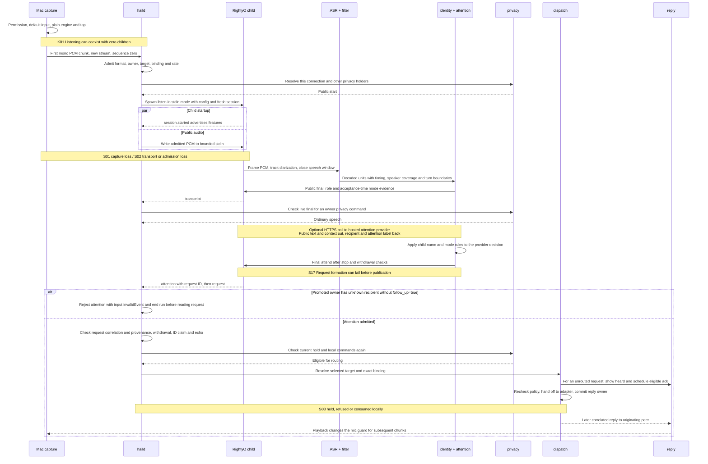
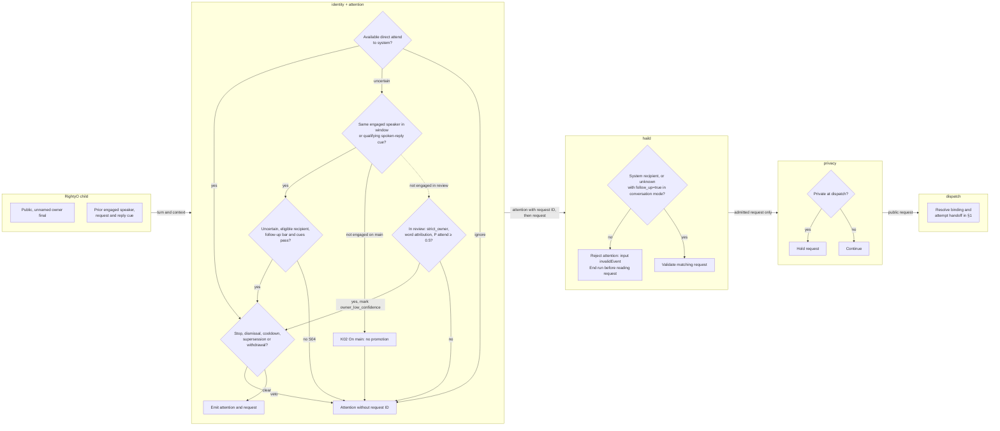
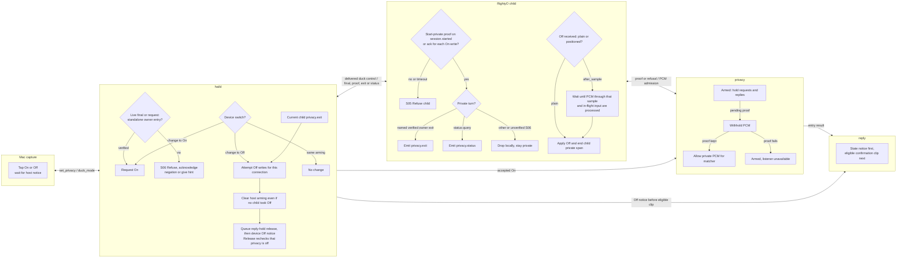
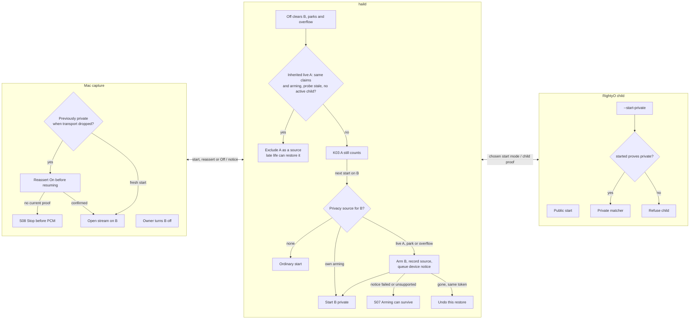
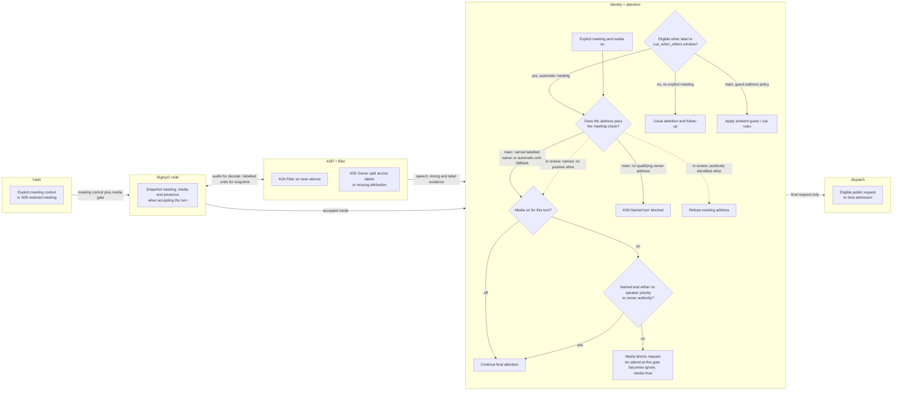
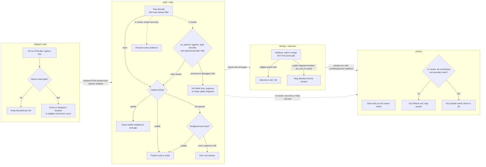
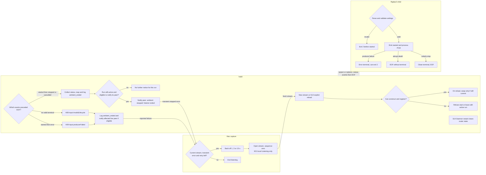
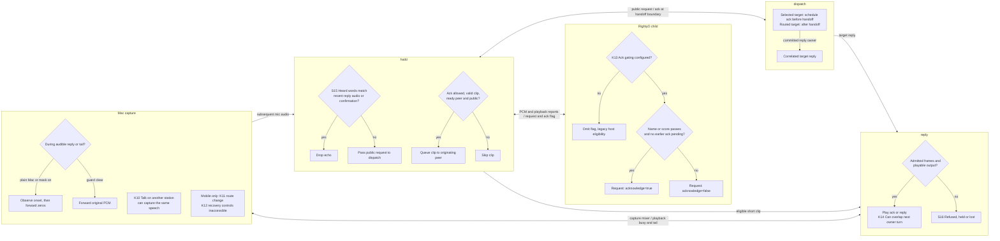

# RightyO capture-to-dispatch swimlanes

A Mac can show **Listening** before haild has a working recognizer. A child can emit a final transcript before it decides whether to send a request. An acknowledgement can play before the target accepts input. Follow the first diagram down to the last boundary with evidence, then use the branch diagrams to find what can happen next. [HS #1483][hs1483]

[Named request](#1-a-named-request-on-a-public-mac-stream) · [Unnamed statement](#2-an-unnamed-owner-statement) · [Privacy switch](#3-entering-and-leaving-privacy) · [Stale holder](#4-why-privacy-can-come-back-after-off) · [Meeting](#5-an-explicit-meeting-or-an-inferred-second-speaker) · [ASR loss](#6-asr-filtering-retry-and-missing-words) · [Child failure](#7-child-startup-failure-reload-and-retry) · [Reply and echo](#8-acknowledgement-reply-playback-and-echo)

**How to read the map.** The eight columns in the sequence are responsibilities. RightyO coordinates ASR and identity. For a public turn, the child can send bounded text and context over HTTPS to a configured hosted provider for a recipient and attention label. A transient provider failure can yield an unavailable decision for that turn. Given a decision, the child applies its own name, mode and follow-up gates. Privacy spans the child and haild. The reply lane includes host delivery and Station playback. See `providers.py:725`, `providers.py:773`, `prototype.py:1891`, `tool_events.py:3559`.

Read each flowchart lane from top to bottom. Labels on arrows between lanes name the data or control exchanged. A **K** number marks a **known**, issue-reported failure. An **S** number marks a **suspected** failure path. Its branch exists in code, but connecting it to a reported incident is an inference. Some gates intentionally refuse a turn. A repeated number denotes the same point throughout.

**Revisions.** Hailing Station is at `67c4906f` and RightyO main at `f134780`. The two **in review** changes for #340 are on separate RightyO branches, `fix/340-meeting-respond-when-addressed` at `4cbfdca` and `fix/whisper-silence-hallucinations` at `dd01083`. Thresholds below are source defaults unless an issue supplies the value for a particular incident. The maps describe source behavior and earlier issue reports. This trace used no live audio or device tests.

**Source key.** Swift citations refer to production files in Hailing Station. Python citations are under `src/rightyo/` at the stated RightyO revision. The row IDs refer to the companion `docs/audio-decision-map.md` at `41538208`. Its prefixes are **M** Mac capture, **H** haild, **R** RightyO, **D** multi-device, **I** iOS/shared recovery and **P** playback. That companion is in the decision-map checkout. Child protocol events travel on stdout. Child diagnostic reasons travel on stderr, which haild ordinarily drains and counts. Device events require diagnostics. A missing host log line alone cannot locate a lost turn. See `RightyoChildSupport.swift:128`, `RightyoChildProcess.swift:64`, `DeviceDiagnostics.swift:501`.

## 1. A named request on a public Mac stream

Read downwards. This example uses the enrolled owner's opening address and the already selected target. The target adapter can return a reply later. The child loads the configuration at spawn. On an already-open stream, start at the next PCM chunk.

| Point | What crosses the boundary and what can fail | Decision map and source |
|---|---|---|
| **K01 · Listening with no listener** | The app tracks local capture/intent. haild's `ambient_started` marks a registered run. Child `session.started`, a public final, a `request` and a completed adapter handoff are successive, independently observable events. The epic reports an on indicator with zero live children during a restart loop. See §7. [HS #1483][hs1483] | M01, I19, H09, H17, R20 · `StationCard.swift:274`, `ListeningPrivacyRailState.swift:123`, `WebSocketListener.swift:1807`, `RightyoAmbientPipeline.swift:315`, `HostSession+Routing.swift:325` |
| **S01 · No usable capture** | Startup needs a current binding, an active scene, mic permission and a running tap on the default input. A route read can reuse cached input. A stall can restart the engine or end capture. Conversion produces 16 kHz signed PCM16 mono in 100 ms chunks. Backlog drops old source buffers before sequencing or old encoded chunks afterwards. An apparent missing onset could lie on either side of that distinction. [HS #1440][hs1440], [HS #1483][hs1483] | M01–M09 · `StationPlatform.swift:79`, `MacDefaultAudioSessionBackend.swift:66`, `Capture.swift:238`, `Capture.swift:290`, `AmbientAudioStreamer.swift:75`, `AmbientAudioStreamer.swift:179`, `AmbientAudioStreamer.swift:418` |
| **S02 · Lost before ASR** | A valid fresh start may take over a stream. An automatic resume yields to another active peer. A stale selection, invalid start/sequence or insufficient byte credit can refuse input. Ingress, reload and stdin queues can drop audio under pressure. Public forward gaps get bounded silence fill (up to 3 s against elapsed time). It preserves some timing but cannot recover the words. [HS #1483][hs1483] | D07, H03–H11 · `HostSession+Routing.swift:96`, `AmbientAudioGate.swift:305`, `AmbientAudioGate.swift:468`, `WebSocketIngressPump.swift:112`, `RightyoAmbientPipeline.swift:406`, `RightyoStdinWriter.swift:44` |
| Named and addressed | Timestamped units join or split at speaker and loss boundaries. A bound owner's opening configured name can promote an available `uncertain` decision. A direct `attend` to the system also works. Meeting, media, guest-address, dismissal and stop gates can still win. Final attention and request carry the correlation ID. An eligible request engages the speaker after emission. | R07–R13, R15–R20 · `live_audio.py:2413`, `turn_merge.py:391`, `tool_events.py:1581`, `tool_events.py:1742`, `tool_events.py:3577`, `tool_events.py:3945`, `tool_events.py:3970` |
| Host attention admission | On main, the opening-name promotion changes the label to `attend` and preserves the provider's recipient. For an `attention` with `attend` and a request ID, haild requires `recipient_kind=system` or `recipient_kind=unknown` with `follow_up=true`. Any follow-up also requires the session to have advertised conversation mode. A promoted `unknown` without the flag ends the run with `input invalidEvent` on the attention record, before haild consumes the request. | H12–H13, R20 · `tool_events.py:3599`, `RightyoInputEvent.swift:319`, `RightyoInputConsumer.swift:938`, `RightyoAmbientPipeline.swift:315` |
| **S17 · Final recognized but request formation fails** | After the child decides to attend, an optional request former can raise or return unusable text. The child ends the session before emitting the request. A final transcript alone cannot distinguish this path from an attention refusal. [HS #1483][hs1483] | R13, R20, H15 · `tool_events.py:4045`, `tool_events.py:4082`, `RightyoInputConsumer.swift:714` |
| **S03 · A request exists but the target gets no input** | haild checks session, sequence, provenance, prior withdrawal and echo, then privacy and local controls. An owner-addressed route needs a resolvable binding. An ambiguous route or pending input can refuse just this request. Confirmation can hold a request for a capable peer or refuse it for Station. A policy/rebind or other terminal failure can end the run. For a routed request the heard notice and ack wait for handoff. The unrouted ack above is asynchronous. [HS #636][hs636], [HS #894][hs894] | H12–H13, H19–H22, R20, P07 · `RightyoInputConsumer.swift:625`, `RightyoInputConsumer.swift:1031`, `RightyoInputConsumer.swift:1079`, `HostSession+Routing.swift:211`, `HostConnection+Protocol.swift:20`, `RightyoAmbientPipeline.swift:45` |

## 2. An unnamed owner statement

Start with a public turn and an available attention decision. Direct address classification runs even with no open conversation. Follow-up promotion uses **the time speech started**, the engaged speaker and the probability of `attend`. The model's confidence in its `uncertain` label is a different number.

| Point | Branch and evidence | Decision map and source |
|---|---|---|
| Inside the window | A request from an eligible stable, non-overlapping speaker opens or extends engagement. The usual time test is `from_ms <= start_ms < until_ms`. Conversation defaults, when enabled, are 20 s and a 0.4 follow-up floor. The setup described in RightyO #342 uses 0.5. A qualifying `uncertain` turn to system/unknown can become `attend` with `follow_up=true`. An enrolled-role floor, an appendix, a pending question or a request-linked spoken reply can change the applicable bar, cue or window. [RightyO #342][ry342] | R17–R18, R26 · `contracts.py:23`, `contracts.py:539`, `tool_events.py:1878`, `tool_events.py:2936`, `tool_events.py:2987`, `tool_events.py:3321` |
| **S04 · Plausible follow-up stays unsent** | An in-window turn can fail on its speaker, recipient, probability, required cue, courtesy/closing, another person's answer, unavailable evidence, or a mode veto. An old engagement cannot grant a guest a follow-up. Inspect `follow_up outcome=refused reason=…` when emitted and `attention` without a request ID. A provider error can independently leave an unavailable decision or end the session. [RightyO #340][ry340], [HS #1483][hs1483] | R13–R19 · `prototype.py:1873`, `tool_events.py:2936`, `tool_events.py:3027`, `tool_events.py:3087`, `tool_events.py:3809` |
| **K02 · Statement after the window lapses** | On main an unnamed owner gets neither the opening-name promotion nor an expired speaker's follow-up. A direct attend-to-system can still send. The epic reports missing owner statements after expiry. Voiceprint ownership alone supplies no instruction to send. [HS #1483][hs1483], [RightyO #340][ry340] | R16–R20 · `tool_events.py:1878`, `tool_events.py:2951`, `tool_events.py:3577`, `tool_events.py:3945` |
| **#340 (b) · In review** | When ordinary follow-up returns `not_engaged`, a public, available provider `uncertain` with word attribution, verified `strict_owner` standing and **P(attend) ≥ 0.5** can form a request. At least one strictly attributed word must exist and all strict words must belong to that owner's label. The child preserves provider recipient and confidence and marks `owner_low_confidence=true` on attention and request. This promotion alone does not set `follow_up`. If it preserves `recipient_kind=unknown`, haild throws `input invalidEvent` on attention before consuming the request (§1). An ordinary eligible follow-up sets `follow_up=true` and can also carry the low-confidence flag. The new path cannot bypass an engaged follow-up refusal, meeting/media block, other answer, stop, dismissal, cooldown or withdrawal, or supersede earlier work. “Always hear the owner” is a separate proposal. [RightyO #340][ry340], [RightyO #342][ry342] | H13, R16–R20 · `RightyoInputEvent.swift:319`, `RightyoInputConsumer.swift:938` · **in review** `tool_events.py:50`, `tool_events.py:3262`, `tool_events.py:3634`, `tool_events.py:3755`, `tool_events.py:3777`, `tool_events.py:3807`, `tool_events.py:3825` |

## 3. Entering and leaving privacy

A tap is a host control. Spoken **entry** is recognized by haild on a public child event. Spoken **exit** must be recognized inside the private child. Once privacy is armed, haild holds requests and ordinary replies. It withholds private PCM from each child until that child proves it can handle it.

| Point | Branch and evidence | Decision map and source |
|---|---|---|
| Tap and live entry | Station sends `set_privacy` and shows pending until a current `duck_mode` notice or a 10 s UI timeout. Tap needs no voice check. A same-state switch normally does nothing. On voice entry haild checks a live non-echo final before request formation and checks the request if needed. An enrolled owner with `voiceprint` or `voiceprint_label` evidence can enter once per utterance. A pre-stream On follows §4. | D01–D02, H14, R22 · `HostConnectionStore.swift:538`, `HostConnectionStore.swift:706`, `WebSocketListener+DuckMode.swift:112`, `RightyoInputConsumer.swift:798`, `RightyoInputConsumer.swift:812`, `RightyoInputConsumer.swift:828` |
| **S05 · On accepted but the listener cannot prove privacy** | First distinguish **no child takes On while off** (stay off, refusal notice/clip) from **already armed but proof fails** (stop/refuse the child, keep privacy). For start-private, inspect the `session` event with `phase=started`. Its top-level `duck` object must carry `duck.version >= 3` and the Boolean `duck.private == true`. The default deadline is 10 s. For running children, each written On needs a `privacy.on` acknowledgement, default 5 s. Haild holds output, closes conflicting modes and gates PCM. The entry ledger waits for proof across participating children before queuing the success clip. Recovery can announce success after an unavailable result without a new tap. [HS #735][hs735], [HS #1483][hs1483] | H11, H14, D02, D05 · `tool_events.py:1165`, `RightyoAmbientPipeline.swift:416`, `RightyoAmbientPipeline.swift:524`, `RightyoAmbientPipeline.swift:566`, `RightyoAmbientPipeline.swift:595`, `RightyoAmbientPipeline.swift:1013`, `RightyoAmbientPipeline.swift:1187`, `RightyoAmbientPipeline.swift:1300`, `WebSocketListener.swift:2597`, `WebSocketListener+PrivacyEntry.swift:127`, `WebSocketListener+DuckMode.swift:139` |
| **S06 · Voice control changes nothing** | A non-owner entry is silently held. Owner-role without live voiceprint gets the refusal clip. An owner's negation leaves recording as it was. A request starting with a command followed by other words can get a hint. While private the child runs the local matcher in memory, suppresses ordinary finals, attention, requests and acks and silences private diarizer input. Status is available to anyone. Exit needs the name and exit phrase entirely within the current privacy period, with binding or isolated owner-voice proof, no inferred attribution or playback conflict. For a split exit, verify **both** parts within 4 s. Unverified speech leaves privacy on. See §6 for the additional decode-integrity check **in review**. [HS #735][hs735], [RightyO #340][ry340] | R22, R24–R25, H14 · `RightyoInputConsumer.swift:841`, `live_audio.py:1919`, `tool_events.py:126`, `tool_events.py:2022`, `tool_events.py:2071`, `tool_events.py:2139` |
| Host Off and clips | For a matched private utterance, the child emits a content-free `privacy.exit` or `privacy.status`. Haild ignores a stale exit while already off. On a current voice exit or valid device Off, haild attempts the child writes, clears the connection's arming even if zero children took Off, and withdraws open privacy entries. On the serial notice queue, reply-hold release comes **before** the device's `duck_mode` notice. The release checks that privacy is still off when it runs. An eligible `confirm-privacy-off` clip follows the notice only when a child took Off. Entry, status and refusal use separate clips. These controls never dispatch to the target. | D04–D05, H14, R22, P07 · `RightyoInputConsumer.swift:856`, `WebSocketListener+DuckMode.swift:56`, `WebSocketListener+DuckMode.swift:93`, `WebSocketListener+DuckMode.swift:153`, `WebSocketListener.swift:2610`, `WebSocketListener.swift:2629`, `WebSocketListener.swift:2784`, `WebSocketListener.swift:2802` |
| Child Off boundary | A host Off notice alone cannot establish when a child left privacy. On stdin, a child with `duck_after_sample` support receives `duck=false` with `after_sample`. It applies Off when it has processed the specified sample and caught up with received PCM. Until then the child keeps the Off pending and stays private. A delivered plain Off applies on receipt. At the child boundary a clean diarizer audit can preserve bindings and conversation. An uncertain audit with input can force renewal. | H11, R22, R24–R25 · `RightyoAmbientPipeline.swift:1197`, `RightyoChildControl.swift:87`, `prototype.py:1795`, `prototype.py:2157`, `prototype.py:2203`, `prototype.py:2251`, `tool_events.py:2195` |

## 4. Why privacy can come back after Off

Connection B opens a new stream. A is an older socket that held privacy. One physical device can account for both. Inheritance is decided **before** child creation on a fresh or resume start.

| Point | Branch and evidence | Decision map and source |
|---|---|---|
| Restore and park | A counting holder's disconnect parks its arming in RAM. Up to 16 parks have no age expiry. Eviction latches overflow. An unarmed B prefers a counting live holder, then the latest park, then overflow alone. Any of them arms B irrespective of device match. Restore ends conflicting mode state, holds replies and sends `duck_mode` with `reason=device`. It leaves the source in place. A hello snapshot is read-only and requires `mode_snapshot`, which this Station hello omits. | D02–D03, D06–D08, H09 · `WebSocketListener+PrivacyPark.swift:45`, `WebSocketListener+PrivacyPark.swift:70`, `WebSocketListener+PrivacyPark.swift:106`, `WebSocketListener.swift:959`, `WebSocketListener.swift:1643`, `WebSocketListener.swift:1707`, `HostConnection+Protocol.swift:20` |
| **K03 · Stale holder re-arms listening after Off** | The #1456 trace showed B inheriting A, B's Off keeping A, then B inheriting A again. Force-quitting the app left a half-open host socket. Compare `ambient_privacy_restored source=live device_match=false` with `ambient_privacy_off_scoped`. An explicit Off clears parks/overflow. Only the recorded live source with matching hello claims and arming is eligible for the ping test. A reply, no probe, mismatch or active child keeps it. A stale verdict excludes its contribution to future restores while A itself stays private. Late life can reinstate it. The host uses socket and hello claims here. Those claims cannot establish a durable physical-device identity. [HS #1456][hs1456], [HS #1439][hs1439], [HS #941][hs941] | D03–D04, D06 · `WebSocketListener.swift:396`, `WebSocketListener.swift:776`, `WebSocketListener+PrivacyPark.swift:151`, `WebSocketListener+PrivacyPark.swift:177`, `WebSocketListener+PrivacyPark.swift:201`, `WebSocketListener+PrivacyPark.swift:230` |
| **S07 · Arming survives a failed notice** | For a pre-arm/restore, only nil or `no_connection` rolls back a still-matching token. A fresh pre-arm can park first. `failed` and `unsupported` leave the arming. That could supply a later live holder even when the device never saw On. This is a contributing hypothesis in #1456. Separately, the Mac On investigated in #1483 was confirmed as an owner tap. The `device` reason by itself cannot distinguish a tap from reconnect or restore. [HS #1456][hs1456], [HS #1483][hs1483] | D01–D03 · `WebSocketListener+PrivacyPreArm.swift:24`, `WebSocketListener+PrivacyPreArm.swift:57`, `WebSocketListener+DuckMode.swift:180`, `WebSocketListener+PrivacyPark.swift:92` |
| **S08 · Private reconnect stops before PCM** | A station that remembers privacy reasserts On before restarting audio. A new socket can pre-arm with no stream. Reconnect needs a successful send and a current-generation On within 5 s. Old-generation notices cannot satisfy it. Send failure, matching Off or deadline ends the attempt. A snapshot-capable authorized peer can clear parks/overflow by Off even while unarmed. [HS #904][hs904] | I13, D02, D08, D11–D12 · `AmbientListeningReconnect.swift:76`, `AmbientListeningReconnect.swift:414`, `AmbientListeningReconnect.swift:581`, `WebSocketListener+PrivacyPreArm.swift:24`, `WebSocketListener.swift:986` |

## 5. An explicit meeting or an inferred second speaker

For an explicit meeting, haild sends `meeting=true` to a child that advertises meeting support and also writes `media=true`. RightyO snapshots each mode when it accepts the turn. The diagram follows a public turn with both controls on, or with both off when the child checks for another speaker. The latter can trigger **automatic meeting**. See `RightyoAmbientPipeline.swift:446`, `RightyoAmbientPipeline.swift:455`.

| Point | Branch and evidence | Decision map and source |
|---|---|---|
| **S09 · A retained meeting gate** | Explicit meeting, rubber-duck and media controls have host arming and expiry. Privacy takes precedence. A subsequent nonprivate stream can restore a live/parked mode until its original expiry. Meeting can resume **without recording**. Compare `ambient_meeting` / `meeting_restored` with the child's `meeting` / `others_present` flags. No host meeting transition is required for inferred presence. [RightyO #340][ry340] | D09–D10, R14–R15 · `WebSocketListener+MeetingMode.swift:95`, `WebSocketListener+ModeRestore.swift:91`, `WebSocketListener+ModeRestore.swift:161`, `tool_events.py:1534`, `tool_events.py:3295` |
| **K04 · Filler on silence creates presence** | RightyO #340 records a near-silence decode assigned a second label and a **120 s** lockout. On main, `cue_when_others_ms=0` disables this history by default. When enabled, a labelled turn meeting duration/word minima (defaults 1,000 ms / 3 words) can enter it. Playback overlap and per-turn owner/trusted roles are excluded. Compare a candidate's end with the new turn's start and engaged/current speaker label. Same-identity evidence can cancel split labels. [RightyO #340][ry340] | R03, R07, R12, R14 · `contracts.py:545`, `tool_events.py:3102`, `tool_events.py:3110`, `tool_events.py:3128`, `tool_events.py:3153` |
| **K05 · Owner split or shown as unknown** | Diarization assigns spans. The voiceprint worker scores eligible non-overlapping labelled speech, then binds or stays tentative/unknown. Unlabelled speech, missing enrollment or insufficient strict coverage can leave an actual owner unverified. A split label can count toward presence on main without a positively different voiceprint. The unlabelled-owner score at this pin is diagnostic only. RightyO #336 proposes **diagnostic** topical similarity. Neither is an owner credential. [RightyO #332][ry332], [RightyO #334][ry334], [RightyO #336][ry336], [RightyO #340][ry340] | R07, R09–R11, R14, R23 · `live_audio.py:738`, `live_speaker_id.py:734`, `live_speaker_id.py:845`, `live_speaker_id.py:1131`, `tool_events.py:1575`, `tool_events.py:3110`, `TranscriptTurn.swift:34` |
| **K06 · Named turns ignored in meeting** | On main, explicit meeting needs configured name, label and owner authority. Automatic meeting applies the same gate when others are present and the ambient guest-address policy is off. Its owner-vocative fallback needs a current voiceprint and an opening name within the diarized head for the same turn end. #340 records positive model attends blocked with `others_present`, `not_owner` or `head_unknown`. A mismatched merged end is one possible mechanism. The optional ask-anywhere setting can promote an eligible owner’s named uncertain turn if the mode bar passes. Automatic meeting refuses ordinary follow-ups. With guest-address policy, presence can instead impose a cue on a possible aside. [RightyO #340][ry340] | R14–R18 · `tool_events.py:2292`, `tool_events.py:2307`, `tool_events.py:2323`, `tool_events.py:2330`, `tool_events.py:2953`, `tool_events.py:2987`, `tool_events.py:3295` |
| **#340 · In-review presence and address** | Presence now needs non-overlapping timeline speech, enough strict words (with a compatibility path for older turns), and an identified participant or qualifying per-turn voiceprint evidence. A pending score alone cannot count. A bound non-owner/non-trusted identity or an unbound score below the owner bar can count, excluding self. A configured name can pass the meeting address check even without attribution or a matching head. A positively identified other vetoes it. With media off, an otherwise eligible public address can promote an available decision to attend-to-system. Owner controls keep their own checks, and ordinary unnamed follow-up rules still apply where policy allows. [RightyO #340][ry340] | R14–R19 · **in review** `tool_events.py:2354`, `tool_events.py:2363`, `tool_events.py:2382`, `tool_events.py:2410`, `tool_events.py:3150`, `tool_events.py:3170`, `tool_events.py:3615`, `tool_events.py:3712` |
| **#340 · In-review explicit meeting with media** | When both host controls took effect, a named, unattributed turn can pass the explicit meeting check and still fail media. With speaker priority configured, media requires owner authority as well as the name. Without that authority a direct `attend` becomes `ignore` with `media=true` and no request. Without speaker priority, the configured name satisfies the media check and the remaining attention gates still apply. | D09, R15, R19 · `RightyoAmbientPipeline.swift:455` · **in review** `tool_events.py:2312`, `tool_events.py:2395`, `tool_events.py:3615`, `tool_events.py:3705` |

## 6. ASR filtering, retry and missing words

The energy gate decides whether there is a window to decode. Decoder VAD (voice activity detection) and the Whisper filters below are a second stage **in review**. The timing-recovery path already exists on main.

| Point | Branch and evidence | Decision map and source |
|---|---|---|
| **K04 · Filler** and **K07 · First word split** | Main compares each frame's normalized RMS with 0.008 by default. Below onset it keeps up to 240 ms pre-roll. Room noise can cross the gate and yield filler on main (§5). Once open, voiced frames reset the clock. Silence hangover (1,440 ms), max duration (12 s), or an eligible optional end-of-turn verdict finalizes. The merger may hold a wake fragment for continuation or release separate turns. A first word in a separate turn was observed. Loss of the first phoneme at the mic is **suspected** (S01/S10). [HS #1440][hs1440], [RightyO #107][ry107], [RightyO #340][ry340] | M07–M08, R02–R08 · `live_audio.py:136`, `live_audio.py:1963`, `live_audio.py:2001`, `live_audio.py:2035`, `turn_merge.py:391`, `turn_merge.py:498` |
| **S10 · Unusable or absent public window** | Quiet speech may never open the gate. Main clamps small timing faults, falls back from words to segment timing, salvages usable neighbours and inserts a loss boundary. An all-rejected window with no usable units may get a bounded local re-decode. Completed windows publish in order. Deadline, backlog, privacy boundary or stop can cancel/discard work. Look for public child `asr_window outcome=salvaged/redecoded/lost`. An entirely missing window cannot supply a transcript or request. [HS #1440][hs1440], [HS #1483][hs1483] | R02–R08, R24 · `live_audio.py:986`, `live_audio.py:1187`, `live_audio.py:1284`, `live_audio.py:2148`, `live_audio.py:2201`, `live_audio.py:2351` |
| **S11 · Genuine speech could be filtered (in review)** | First decode without VAD. Match whole raw speaker turns for standalone privacy entry before filtering. A placed entry can survive changed segmentation. Unplaceable entry has unknown identity unless a corroborating retry supplies timing. For ordinary local Whisper segments, drop `no_speech` probability **above 0.8**, mean log probability **below −1.5**, or a whole-word blocklist match with low measured energy (defaults). The quiet check also covers phrases assembled across segments. A configured VAD model adds a second decode with default threshold 0.5. Public `asr_dropped reason=… count=…` distinguishes rejection from no onset. Fully filtered speech produces no ordinary final. Retained public fragments marked with ASR loss cannot run attention or supply its later context. [RightyO #340][ry340] | R03, R05–R08, R13, R22 · **in review** `whisper_filter.py:70`, `whisper_filter.py:104`, `whisper_filter.py:119`, `live_audio.py:1028`, `live_audio.py:1417`, `live_audio.py:1455`, `live_audio.py:1503`, `live_audio.py:1702`, `live_audio.py:2747`, `pipeline.py:436`, `prototype.py:1135` |
| **S12 · Owner exit refused on an incomplete decode (in review)** | A clean-looking surviving phrase cannot release privacy if its turn **or any contributing decode window** is damaged. Filtering/VAD changes, empty or repaired timing, a dropped unit, retry or loss can invalidate it. A loss between split name and exit also breaks continuity. Raw **entry** protection never authorizes an exit. The child can report only `privacy exit_refused reason=asr_loss` for this refusal. It clears split evidence, stays private, and can accept a fresh clean owner-verified command immediately. [RightyO #340][ry340] | R05–R06, R22, R24 · **in review** `live_audio.py:1484`, `live_audio.py:1714`, `live_audio.py:2786`, `live_audio.py:3110`, `tool_events.py:1332`, `tool_events.py:2115` |

## 7. Child startup, failure, reload and retry

The OS exit status and the stdout protocol answer different questions. The order of `started`, terminal event and EOF determines what haild can report. The clean-exit path below assumes the target session is unchanged. A successful reload response means the router installed the replacement. The replacement still has to read its configuration and produce events.

| Point | Branch and evidence | Decision map and source |
|---|---|---|
| **K08 · Invalid config / missing lifecycle** | Before spawn, unsafe executable/ancestry or unreadable/nonregular config gives a host refusal such as `child unsafeConfig`. After spawn, RightyO loads the JSON and validates options/assets. `conversation.window_ms` must be 1,000–120,000. #1483 identifies an out-of-range value in one restart burst. Setup failure prints to child stderr and exits **2 before started**. EOF without a terminal event maps to `input invalidLifecycle`. A crash after started but before terminal can produce the same mapping. It does not identify the offending setting. [HS #1483][hs1483] | H01, H09–H10, H12, H15, R01 · `RightyoChildSupport.swift:54`, `tool.py:322`, `prototype.py:407`, `contracts.py:566`, `cli.py:502`, `RightyoInputConsumer.swift:714`, `RightyoAmbientPipeline.swift:336` |
| **K09 · Producer failure after startup** | Once started, a processor failure can emit `session.error` and exit 2. An input overrun discards the unfinished tail. On a valid error terminal, `finish()` throws `producerFailed`. Protocol or dispatch errors can throw earlier. Privacy-proof failure has its own refusal. After an admitted stopped/cancelled terminal and EOF, haild collects the exit status. A still-active child exit can still end the stream. #1483 recorded both error names. The config incident establishes the cause of one burst only. [HS #1483][hs1483] | R01–R02, H12–H17 · `prototype.py:1601`, `prototype.py:2396`, `tool.py:435`, `RightyoInputConsumer.swift:876`, `RightyoInputConsumer.swift:715`, `RightyoAmbientPipeline.swift:337`, `WebSocketListener.swift:2038` |
| Retry and **K01** | haild logs `ambient_ended` on clean and failed runs. A clean end after the stream has already ended needs no notice. If the clean run still owns the active stream and the target session is unchanged, haild reports `ambient stopped: listener exited` to the originating peer. Replaced or already-reported runs skip notification, as does a missing listener. Station treats the resulting `not_allowed: ambient stopped:` prefix as transient. With the streamer still live and retries available, it opens a fresh stream on the same capture after **1, 3, 10 s** on successive attempts. The budget resets after 120 s since the last recovery. Exhaustion ends listening. Each new child can reject the same file. Compare the device's `ambient_start` with host `ambient_started` / `ambient_ended` and actual child finals. [HS #1483][hs1483] | I13, M09, H15–H17 · `WebSocketListener.swift:568`, `WebSocketListener.swift:2058`, `WebSocketListener.swift:2073`, `HostConnectionStore.swift:1416`, `HostConnectionStore.swift:1423`, `HostConnectionStore.swift:1453`, `AmbientAudioStreamer.swift:495` |
| **S13 · Replacement loses a pending turn or fails immediately** | `haild ambient reload` requires an active run and capacity. Construct first, retaining stream, selected target and binding. On construction failure log `ambient_reload_refused` and leave a still-active predecessor running. Recheck identity/capacity under lock before swap. A lost race reaps the unused child. Success logs `ambient_reloaded` then `ambient_started` for the replacement and retires the old child. A new child session rereads the same file. Pending audio, engagement and uncompleted work can be lost at the boundary. Host path checks do not parse the child schema before swap. [HS #405][hs405], [HS #1483][hs1483] | H08–H10, H15–H17 · `WebSocketListener.swift:1685`, `WebSocketListener.swift:1807`, `WebSocketListener.swift:2134`, `WebSocketListener.swift:2147`, `WebSocketListener.swift:2169`, `RightyoAmbientPipeline.swift:286`, `tool.py:322` |
| **S14 · State absent after daemon restart** | A new router has no previous children, sockets, binding for the active stream, privacy parks/overflow or engagement. Station may reconnect, reselect and reassert its own privacy (§4). Persisting explicit session/owner intent across restart, validating config before replacement and surfacing end-to-end hearing health within 5 s are epic acceptance criteria. They are proposed work at these pins. [HS #1483][hs1483] | H18, H21, D03, D11–D12 · `WebSocketListener.swift:845`, `WebSocketListener.swift:1133`, `WebSocketListener+PrivacyPark.swift:7`, `AmbientListeningReconnect.swift:401`, `AmbientListeningReconnect.swift:414` |

## 8. Acknowledgement, reply playback and echo

The short host clip and the target's reply have independent admission and timing. Both can reach the same output and affect the next captured turn. The feedback arrow below starts the next trip through §1.

| Point | Branch and evidence | Decision map and source |
|---|---|---|
| **K13 · Instant ack cannot be controlled in Station** | With child ack gating configured, a configured name or sufficient confidence qualifies. A direct request uses decision confidence. A follow-up uses P(attend) and can have its own stricter floor. A still-pending ack can suppress a second clip. Main omits the field when gating is absent. With a host clip library the relay treats a missing field as legacy eligibility. An advertised gate and `acknowledge=false` skips only the clip. #1465 and its companion request an owner-facing switch. [HS #1465][hs1465], [RightyO #339][ry339] | R21, P07 · `tool_events.py:4008`, `tool_events.py:4032`, `RightyoAmbientPipeline.swift:838`, `RightyoAmbientPipeline.swift:863`, `WebSocketListener.swift:1845` |
| Clip delivery | Haild rotates valid mono PCM16 WAVs from the named/remembered persona or default pool. No callback/library, no clip, changed target, absent peer, denied permit or privacy hold can leave the request silent. Reserved clips (privacy on/off/status, refusal, not-sent) use separate pools. Unrouted acknowledgement runs before the adapter attempt. An input-pending refusal can follow it with a refusal notice and then a not-sent clip. Routed acknowledgement waits for handoff. `ambient_acknowledged outcome=sent` records host transport success. | H19, R21–R22, P07 · `AmbientAcknowledgement.swift:108`, `AmbientAcknowledgement.swift:216`, `RightyoAmbientPipeline.swift:45`, `RightyoAmbientPipeline.swift:883`, `WebSocketListener.swift:1848`, `WebSocketListener+Acknowledgement.swift:44`, `RightyoInputConsumer.swift:1079` |
| **S16 · Reply sent but no audible answer** | Correlated publication needs an eligible owning peer. Requestless fallback must resolve an allowed recipient. Recheck selection, privacy and stop fences. Station checks descriptor, format and sequence, buffers contiguous audio and starts at the queue head. A pause, mute, Talk hold, route/engine error, missing first audio, missing final or underrun can delay or lose playback. Compare host admission with device `reply_playback_start/end/error`. End gap counters measure underruns. Only a physical observation establishes audibility. [HS #1455][hs1455], [HS #1483][hs1483] | P01–P06, P08, P11 · `HostReplyDelivery.swift:1516`, `HostReplyDelivery.swift:1603`, `HostConnection+Protocol.swift:125`, `ReplyPlaybackController.swift:128`, `PCM16AudioPlayer.swift:162`, `ReplyPlayoutBuffer.swift:56`, `ReplyPlaybackController+Idle.swift:97`, `DeviceDiagnostics.swift:388` |
| **K14 · Reply starts while the owner is speaking** | #1457 records an early endpoint, multiple fragment requests and an ordinary reply playing over a later fragment. While playing and for the default **400 ms** tail, Mac plain capture masks the mic. The activity and onset detectors see the original buffer. The guard then zeroes its samples before conversion and preserves stream timing. Tap-to-talk and its tail always mask locally. With effective in-graph echo cancellation on mobile and masking disabled, live speech can pass. Segment-boundary yield has its own timing/eligibility checks. A general hold on ordinary reply starts during owner speech is requested in #1457. [HS #1457][hs1457], [RightyO #107][ry107] | M04, R03–R08, I04–I05, P05, P09, P13–P14 · `StationPlatform.swift:79`, `live_audio.py:1977`, `AmbientReplyEchoGuard.swift:20`, `AmbientReplyEchoGuard.swift:343`, `AmbientReplyEchoGuard.swift:605`, `AmbientReplyEchoGuard.swift:669`, `ReplyPlaybackController+Segments.swift:91` |
| **S15 · Echo leaks through or real speech is masked/matched** | The device mask can erase an overlapping owner turn. With reply controls enabled, haild can translate a current device playback start/end/error diagnostic into a child playback phase (error maps to ended). A request-scoped outcome governs the conversation once that reporting is active. Separately, child self-voice needs configured reply-window/echo evidence. Host-reported playback overlap excludes some presence candidates. Independently, haild drops a formed request if its heard words match recent reply audio (at least 5 words and 85% adjacent-pair overlap). An eligible sent confirmation recorded with its text can match an exact normalized phrase during playout plus 4 s. Missing text, short/mixed echoes or insufficient self evidence can escape. An owner repeating a reply could match. These are possible causes of missed or phantom turns. [RightyO #340][ry340], [HS #1483][hs1483] | P09–P10, P17, R12, R14, R26 · `self_voice.py:248`, `tool_events.py:2543`, `tool_events.py:3102`, `WebSocketListener.swift:1053`, `RightyoInputConsumer.swift:437`, `RightyoInputConsumer.swift:639`, `RightyoAmbientPipeline.swift:699`, `RightyoAmbientPipeline.swift:812` |
| **K10 · A second mic still captures** | Tap-to-talk on one device while another streams ambient produced two captures. A local Talk mask affects only that device's buffers. Fresh ambient takeover and automatic resume have distinct admission rules. Compare the two capture paths and the host's moved-stream outcome before attributing a duplicate to ASR. [HS #1433][hs1433], [HS #1439][hs1439] | M11, I16–I18, D06–D07, P09 · `Apps/Hail-iOS/StationTalkSession.swift:16`, `AmbientReplyEchoGuard.swift:97`, `AmbientAudioGate.swift:415`, `AmbientHandoff.swift:19` |
| **K11 · Mobile headset change stops capture and reply** | In #1455 a mid-session hardware route change ended capture and the playing reply failed. On iOS the capture-mode choice samples output at start. Headset output can coexist with a built-in mic. Compare route changes, capture mode, `ended_by_system` and player error. On native Mac the plain engine follows system defaults. **K12 · Recovery controls inaccessible** was separately reported for the mobile More menu, upstream of any new capture/route decision. [HS #1455][hs1455], [HS #1454][hs1454], [HS #1429][hs1429] | M02–M04, I01–I09, P04, P06 · `AmbientCaptureMode.swift:39`, `AmbientCaptureMode.swift:62`, `Capture.swift:206`, `ManagedAudioSession+BluetoothHFP.swift:30`, `Apps/Hail-iOS/StationTalkDock.swift:44`, `RootView+StationScreen.swift:91` |

[hs405]: https://github.com/mickdarling/hailing-station/issues/405
[hs636]: https://github.com/mickdarling/hailing-station/issues/636
[hs735]: https://github.com/mickdarling/hailing-station/issues/735
[hs894]: https://github.com/mickdarling/hailing-station/issues/894
[hs904]: https://github.com/mickdarling/hailing-station/issues/904
[hs941]: https://github.com/mickdarling/hailing-station/issues/941
[hs1429]: https://github.com/mickdarling/hailing-station/issues/1429
[hs1433]: https://github.com/mickdarling/hailing-station/issues/1433
[hs1439]: https://github.com/mickdarling/hailing-station/issues/1439
[hs1440]: https://github.com/mickdarling/hailing-station/issues/1440
[hs1454]: https://github.com/mickdarling/hailing-station/issues/1454
[hs1455]: https://github.com/mickdarling/hailing-station/issues/1455
[hs1456]: https://github.com/mickdarling/hailing-station/issues/1456
[hs1457]: https://github.com/mickdarling/hailing-station/issues/1457
[hs1465]: https://github.com/mickdarling/hailing-station/issues/1465
[hs1483]: https://github.com/mickdarling/hailing-station/issues/1483
[ry107]: https://github.com/mickdarling/rightyo/issues/107
[ry332]: https://github.com/mickdarling/rightyo/issues/332
[ry334]: https://github.com/mickdarling/rightyo/issues/334
[ry336]: https://github.com/mickdarling/rightyo/issues/336
[ry339]: https://github.com/mickdarling/rightyo/issues/339
[ry340]: https://github.com/mickdarling/rightyo/issues/340
[ry342]: https://github.com/mickdarling/rightyo/issues/342
